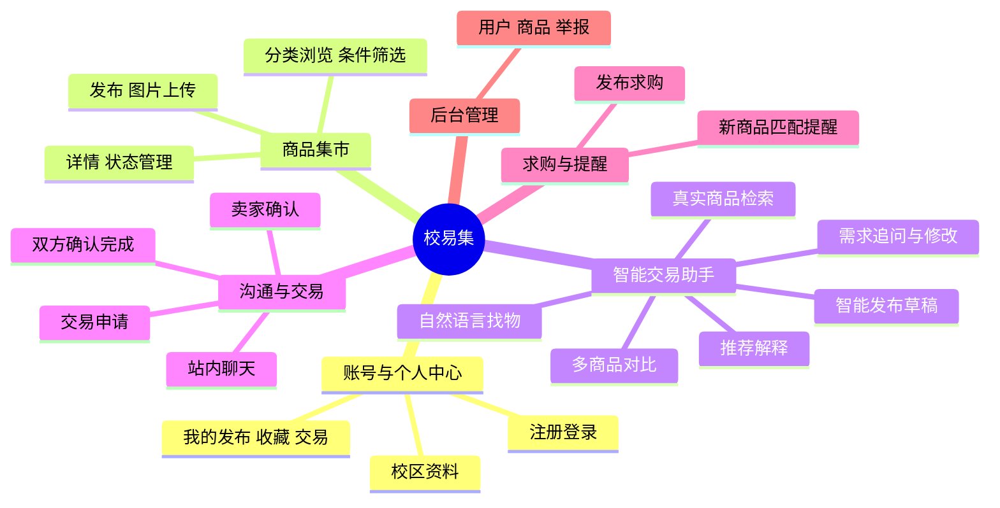
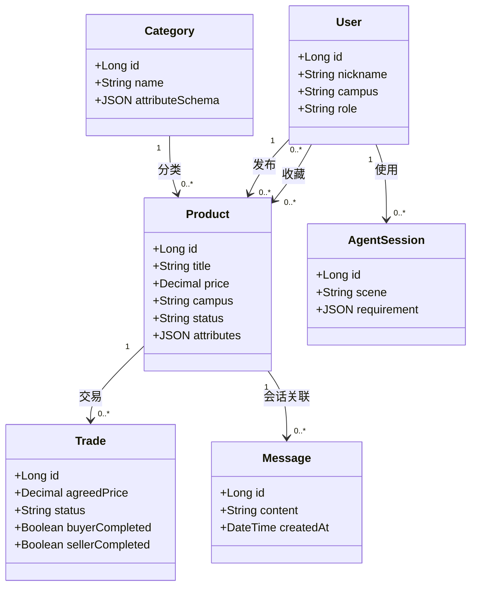

# 【草稿·待替换占位】校易集 CampusSwap —— 团队第一次作业博客

> **使用说明（提交前删除本块）**
> 1. 文中所有 `【】` 都是必须替换或补充的占位，不能原样提交。
> 2. 标 `【需核实】` 的地方是我按常规理解写的，提交前要用真实截图/链接/数据核对一遍。
> 3. **调研数据一律不要编**。第二节的调研结论目前是空的，按 `03-博客待补清单.md` 里的问卷和访谈提纲跑一轮再填。
> 4. 博客正文控制在 3000–5000 字，需求细节全部放语雀/腾讯文档链接，不要把需求文档全文粘进博客。

---

## 作业信息

| 项目 | 内容 |
|---|---|
| 作业所属课程 | [软件工程](【课程班级链接】) |
| 作业要求 | [团队项目第一次作业：团队展示+选题报告+需求分析](【作业要求链接】) |
| 作业的目标 | 用一次完整的"调研 → 选题 → 需求 → 验收"闭环，证明团队要做的产品是真实存在需求的、智能体是嵌在系统里而非外挂的、功能范围是可交付的；同时把团队分工、迭代节奏和验收标准固定下来，作为后续开发和期末验收的依据。 |
| 团队名称 | 拾集小队 |
| 团队成员 | 2023xxxxxxx-【姓名1】、2023xxxxxxx-【姓名2】、2023xxxxxxx-【姓名3】、2023xxxxxxx-【姓名4】、2023xxxxxxx-【姓名5】、2023xxxxxxx-【姓名6】、2023xxxxxxx-【姓名7】 |
| 项目名称 | 校易集 CampusSwap（暂定，可改） |
| 需求文档 | [校易集需求规格说明书（语雀/腾讯文档）](【文档链接】) |
| 在线体验 | 【部署地址 / 二维码，若本次尚无则写"迭代一交付后提供"】 |

---

## 一、队名与释义

**队名：拾集小队**

"拾集"有两层意思：一是**拾**（把闲置的东西捡起来重新用起来），二是**集**（集市、聚集）。合起来就是我们想做的事——把散落在各个宿舍、各个群里卖不掉的闲置，重新聚集成一个能被检索、能被信任的集市。

队名里的"拾"也谐音"十"，但我们只有七个人，所以我们更喜欢另一种解释：**七个人，把别人不要的东西捡回来做成一个产品。**

【备选队名，如需更换可整段替换：易集七人组 / 闲置七仓 / SwapSquad】

---

## 二、项目规划与描述

### 2.1 一句话定位

> **校易集是一个面向在校学生的校园二手交易平台，内嵌智能交易助手：买家说一句"我想买台宿舍写代码用的显示器，300 以内，只要南校区"，就能拿到真实在售的商品清单、推荐理由和缺失信息提示；卖家拍张照片说一句话，就能拿到一份可以直接改的发布草稿。**

### 2.2 我们调研到的真实问题

【这一节必须用真实调研数据替换，以下是结论框架，不是结论本身】

我们在 【时间】 对 【N】 名在校学生做了问卷，并对 【M】 名有闲置交易经历的同学做了访谈，得到三个反复出现的痛点：

| 痛点 | 典型原话 | 现有方案为什么解决不了 |
|---|---|---|
| **想卖卖不掉：发布成本高** | 【访谈原话，例："挂闲鱼要拍图、写标题、填一堆属性，我嫌麻烦就直接扔了"】 | 全平台 App 的属性表单是按"商品"设计的，不是按"学生随手一发"设计的；描述写得含糊，买家不敢问 |
| **想买买不到：搜不出来** | 【访谈原话，例："我就是想买个便宜的台灯，不知道搜什么词"】 | 关键词搜索要求用户先知道商品叫什么；校内群是刷屏式信息流，几天就沉底，无法检索 |
| **不敢交易：信息不透明、没有边界** | 【访谈原话，例："群里问价容易被放鸽子，也不知道对方是不是本校的"】 | 群聊没有商品状态（还在不在）、没有校区范围、没有交易进度记录，全凭口头 |

**调研结论**：校园二手的核心矛盾不是"没有供给"，而是**供给的表达成本太高、需求没有被翻译成可执行的查询**。这两件事恰好都是语言模型擅长的——这也是我们把智能体放进系统的原因，而不是为了"用 AI 而用 AI"。

### 2.3 智能体在系统里的位置（关键，决定选题是否合格）

**智能体不是外挂的聊天框，它是系统的一个"入口层"**，与页面按钮共用同一套业务服务：

```
用户自然语言
     │
     ▼
智能体（意图理解 → 条件抽取 → 选择工具 → 组织回答）
     │  调用固定 JSON 结构的工具
     ▼
业务服务（商品检索 / 详情 / 对比 / 草稿创建）  ←── 同一个服务 ──→  页面筛选按钮
     │
     ▼
MySQL 真实数据
```

三条硬规矩（写进需求文档，也是答辩时的加分点）：

1. **商品名称、价格、状态、卖家信息一律由数据库返回，模型不得生成**；模型只负责"理解需求"和"解释结果"。
2. **硬条件（预算上限、校区、类别）由后端 SQL 过滤执行**，模型不能自己放宽；要放宽必须先问用户。
3. **信息缺失要明示**（"接口类型未填写"），不允许用模型常识补齐。

### 2.4 功能范围（明确"做什么"和"不做什么"）

**必须完成（MVP，期末验收必须全部可演示）**

| 模块 | 内容 |
|---|---|
| 账号与个人中心 | 注册登录、校区设置、我的发布/收藏/交易 |
| 商品集市 | 发布（含图片上传）、分类浏览、条件筛选、详情、状态管理（在售/已预订/已售出/已下架） |
| 智能找物 | 自然语言条件抽取、多轮补充与修改、真实商品检索、推荐解释、无结果处理、商品卡片直连详情/收藏/咨询 |
| 智能发布 | 图片+一句话 → 追问缺失信息 → 生成可编辑草稿 → 用户确认后发布 |
| 沟通与交易 | 站内聊天、交易申请、卖家确认（并发只允许一单）、双方确认完成 |
| 基础后台 | 用户管理、商品下架、举报处理 |

**完成主线后增加（写进文档但不作为验收硬指标）**

- 商品对比（2–3 件，维度随类目变化，缺失项明示）
- 求购发布 + 新商品规则匹配提醒
- 浏览统计

**本期不做，明确写进"不做的范围"**：在线支付与资金托管、物流、跨校运营、实名认证、推荐算法（首版用规则排序）、向量检索（先用结构化筛选+关键词）。

> 这一节是防"画大饼"的关键。答辩时老师最容易问的是"这些都做得完吗"，答案就是这张表和下面的迭代计划。

### 2.5 技术方案

| 层次 | 选型 | 理由 |
|---|---|---|
| 前端 | Vue 3 + TypeScript + Vite + Element Plus | 响应式 Web，电脑答辩、手机体验都能用；团队上手快 |
| 后端 | Python FastAPI | 与智能体 SDK 同语言，工具调用和异步流式输出好写 |
| 数据库 | MySQL 8 | 事务能力用于交易并发控制；分类属性用 JSON 字段，避免为每个类目建表 |
| 智能体 | 支持工具调用（Function Calling）+ 图像理解的模型 API【需核实：确定具体平台与模型，如扣子/Dify/DeepSeek/通义】 | 统一在后端调用，密钥不上前端 |
| 实时消息 | WebSocket | 聊天体验 |
| 图片存储 | 开发期本地目录，部署期对象存储 | 先跑通再优化 |
| 部署 | 云服务器 + Nginx + HTTPS + Docker Compose | 保证"能上线、能被点开验收" |

### 2.6 迭代计划（5 轮，每轮结束必须有可演示增量）

| 迭代 | 时间 | 目标 | 可演示的增量 | 负责人 |
|---|---|---|---|---|
| **迭代 0** | 至 11-09 | 规划定稿 | 本次答辩 PPT、博客、需求文档 V1.0 | 全员 / PM |
| **迭代 1** | 11-10 ~ 11-16 | **基础可运行 + 首次部署** | 注册登录、发布商品（图+表单）、集市列表与筛选、详情页，**外网可访问** | 前端A、后端A、运维 |
| **迭代 2** | 11-17 ~ 11-23 | **智能体主线（杀手级功能）** | 一句话找货→真实商品卡片→多轮改条件→无结果引导；降级开关可用 | 智能体、前端B、后端A |
| **迭代 3** | 11-24 ~ 11-30 | 交易闭环 | 站内聊天、交易申请、卖家确认（并发）、双方确认完成、后台下架 | 后端B、前端B |
| **迭代 4** | 12-01 ~ 12-07 | 智能发布 + 对比 | 图片+一句话生成草稿、2–3 件商品对比、求购匹配提醒 | 智能体、前端B |
| **迭代 5** | 12-08 ~ 12-14 | 打磨与验收 | 全量验收用例通过、性能与异常状态补齐、演示录屏、最终部署 | 全员 / QA |

> 【需确认期末验收时间，按实际时间倒推上表日期；若时间更紧，把迭代 4 的"求购提醒"移出范围。】

---

## 三、队员风采

| # | 学号 | 姓名（可昵称） | 性格 | 擅长技术 | 兴趣爱好 | 希望的软工角色 |
|---|---|---|---|---|---|---|
| 1 | 2023xxxxxxx | 【姓名1】 | 【例：话少但靠谱，负责催进度】 | 【产品设计 / Axure / 写作】 | 【跑步、看纪录片】 | **PM / 需求 / 答辩主讲** |
| 2 | 2023xxxxxxx | 【姓名2】 | 【例：细节控，UI 像素级对齐】 | 【Vue3 / TS / CSS】 | 【摄影】 | **前端负责人** |
| 3 | 2023xxxxxxx | 【姓名3】 | 【例：爱折腾交互和动画】 | 【Vue3 / WebSocket】 | 【游戏、剪辑】 | **前端** |
| 4 | 2023xxxxxxx | 【姓名4】 | 【例：架构思维，喜欢画图】 | 【FastAPI / MySQL / Docker】 | 【骑行】 | **后端负责人** |
| 5 | 2023xxxxxxx | 【姓名5】 | 【例：抠边界条件，爱写测试】 | 【Python / 并发 / Redis】 | 【下棋】 | **后端** |
| 6 | 2023xxxxxxx | 【姓名6】 | 【例：玩过不少大模型，爱调提示词】 | 【LLM / Function Calling / 图像理解】 | 【AI 应用、播客】 | **智能体 / AI 工程** |
| 7 | 2023xxxxxxx | 【姓名7】 | 【例：沉稳，收尾靠他】 | 【Linux / Nginx / 自动化测试】 | 【羽毛球】 | **测试 / 部署 / 运维** |

**每人一句自述（建议每人补 30–50 字，博客更有温度）**

- **【姓名1】**：【为什么想做这个项目，例：我自己宿舍堆了三箱卖不掉的书，所以特别想解决"发布太麻烦"这件事。】
- **【姓名2】**：【…】
- **【姓名3】**：【…】
- **【姓名4】**：【…】
- **【姓名5】**：【…】
- **【姓名6】**：【…】
- **【姓名7】**：【…】

---

## 四、团队首次合照

【插入合照：建议横版 16:9，全员露脸，光线正常。答辩 PPT 首页复用同一张，视觉统一。若无合照，务必本周内补拍——这一项是明确的评分项，不能空。】

---

## 五、团队愿景（约 100 字）

> 我们希望校易集成为每所学校里"默认的那一个"二手入口：学生不再需要加十个群、翻几百条消息才能卖掉一台旧显示器，也不必先想好关键词才能找到想要的东西。它应该像一个熟悉校园的同学——你说清楚要什么、有多少钱、在哪个校区，它就把真实存在的选择摆到你面前，并诚实告诉你哪些信息还不知道。让闲置真正流动起来，让校园里的浪费少一点。

---

## 六、选题报告

### 6.1 选题来源

选题来自【本校/本校区】的真实观察与调研：每个学期末都有一批搬宿舍、毕业的学生需要处理闲置，每个学期初都有一批新生需要买便宜的日用品和教材，但两边始终靠 QQ 群、微信群和校园墙撮合。我们在调研中确认了这个中间环节的三个具体损耗（见 2.2），并把方案收敛到"降低表达成本 + 把需求翻译成查询"这一件事上。

### 6.2 同类产品对比

| 维度 | 闲鱼/转转等全平台 C2C | 校内 QQ/微信群、校园墙 | **校易集** |
|---|---|---|---|
| 校区/校内范围过滤 | 无（全国流量，同城也常跨区） | 群成员天然同校，但无法按校区筛选 | 有，校区是一等公民字段 |
| 商品可检索性 | 有搜索，但要求知道关键词 | 无检索，信息流刷屏即沉底 | 结构化筛选 + 自然语言描述需求 |
| 商品状态是否可信 | 大量已售不更新 | 全靠卖家口头 | 在售/已预订/已售出状态机强制流转 |
| 交易过程是否有记录 | 有平台担保 | 无 | 有交易单与双方确认（线下交接，不做支付） |
| 发布成本 | 表单长、类目属性多 | "出个台灯 25" 极简但信息不全 | 图片+一句话 → 追问 → 草稿预填 |
| 信息完整性 | 依赖卖家自觉 | 极低 | 缺失字段强制明示，AI 只建议不编造 |

【需核实：请为前两列各截 2–3 张图作为证据（闲鱼的搜索页、校园群里的交易消息打码截图），放进 PPT。】

### 6.3 创新点（只讲三个，讲多了等于没讲）

1. **需求驱动检索**：用户从"用途 + 预算 + 约束"出发描述，系统把它转成可执行的查询条件，而不是要求用户先猜对商品名。
2. **基于平台真实数据的推荐与对比**：所有候选都关联真实在售记录，推荐解释里明确写出"符合什么、缺什么"，把 AI 的不确定性变成可见的取舍。
3. **买卖双侧辅助**：买方得到筛选帮助，卖方得到发布帮助，两头都在提升**信息质量**——这是普通搜索和普通表单做不到的。

### 6.4 杀手级功能

**「需求直达」：一句话 → 真实在售清单 → 直接发起咨询。**

演示脚本（30 秒，答辩必放）：

> 输入"我想买台宿舍写代码用的显示器，300 以内，只要南校区"
> → 系统抽出条件标签：显示器 / ≤¥300 / 南校区 / 用途：编程
> → 检索到 3 件真实商品，卡片上标注"符合预算""同校区""接口类型未填写"
> → 提示"你还没说电脑接口，买之前要确认能否直连"
> → 接着说"预算降到 200" → 只更新预算，其余条件保留，结果实时变化
> → 点卡片 → 进详情 → 发起咨询（落到真实聊天）

**为什么它"杀手"**：它同时展示了感知（理解模糊需求）、决策（追问 or 直接给结果）、工具调用（查真实数据库）、反馈（结果可解释、可继续操作）四件事，而这四件事缺任何一件都做不出这个效果。这是"套一个聊天框"做不到的。

**第二亮点：智能发布**——上传照片 + "毕业出台灯 25 块北校区自取" → 追问"能正常用吗/带电源线吗/有损坏吗" → 生成预填表单，用户改完点确认才入库。

---

## 七、需求分析文档

需求规格说明书单独维护（在线协作，便于多人编辑与历史追溯）：

**📄 [校易集需求规格说明书 V1.0](【文档链接】)**

文档结构（按《软件需求规范》组织）：

1. 引言（目的、范围、术语、参考资料）
2. 总体描述（产品前景、用户角色、运行环境、约束与假设）
3. **迭代记录表**
4. 项目标志（Logo 与视觉说明）
5. **业务思维导图**
6. **类图与数据模型**（12 个核心实体 + 关键约束）
7. **功能需求**：按模块逐条编号，每条含"前置条件 / 主流程 / 异常流程 / 涉及接口"
   - 前端部分：10 个页面的布局、交互、状态（加载/空/失败/降级）
   - 后端部分：模块划分（auth/users/products/chat/trades/agent/needs/admin）、接口清单、权限矩阵
   - **智能体接口约定**：6 个工具的 JSON 参数与返回结构、上下文维护规则、不得编造数据的约束
8. 非功能需求（性能、安全、可用性、兼容性）
9. **验收标准**（AC-01 ~ AC-14，每条含输入、操作、预期结果，可逐条勾选）
10. 附录：AI 固定测试集与通过率记录表

**本博客不重复正文，下面只摘三张关键图，细节见文档。**

### 7.1 业务思维导图（节选）



### 7.2 核心类图（节选）



### 7.3 验收标准（摘要，完整 14 条见文档）

| 编号 | 功能 | 验收场景与预期 |
|---|---|---|
| AC-01 | 商品发布 | 必填项完整 + 图片上传成功后可发布并能在集市查到；缺必填项时明确提示原因 |
| AC-03 | 自然语言找物 | 输入"南校区 300 元以内的显示器"，能抽取出条件并返回对应**在售**商品 |
| AC-04 | 连续对话 | 接着说"预算降到 200"，保留其他已确认条件，只更新预算 |
| AC-05 | 无结果处理 | 无匹配时明确提示，**不编造商品、不自行放宽硬条件** |
| AC-07 | 智能发布 | 图片+描述生成草稿，卖家修改并确认后才正式发布 |
| AC-10 | 并发抢单 | 两名买家同时申请，卖家只能成功确认其中一笔有效交易 |
| AC-13 | 服务降级 | 模型调用失败时给出重试提示，普通搜索与手动发布仍可用 |
| AC-14 | 上线访问 | 外部浏览器通过部署地址可完成登录、找物、咨询、交易主流程 |

> AC-14 是我们给自己定的硬指标：**迭代一结束就要有能点开的地址**，之后每轮迭代都在同一个地址上演进，不做"最后一周才部署"的赌注。

---

## 八、团队分工与协作机制（七人）

### 8.1 分工

| 角色 | 成员 | 主责 | 本轮交付物 | 关键迭代 |
|---|---|---|---|---|
| **PM / 需求 / 主持答辩** | 【姓名1】 | 需求文档单点维护、原型、排期与风险跟踪、博客、答辩主讲 | 需求说明书 V1.0、原型图、4 分钟答辩稿 | 迭代 0 主导，全程护航 |
| **前端负责人** | 【姓名2】 | 前端工程与规范、集市/首页/详情/发布/个人中心 | 页面骨架与设计规范、集市全流程 | 迭代 1、2 主攻 |
| **前端** | 【姓名3】 | 智能助手对话页、对比页、聊天、交易中心、异常与降级状态 | 对话+结果组合布局、多状态页面 | 迭代 2、3 主攻 |
| **后端负责人** | 【姓名4】 | 数据库设计、账号权限、商品/分类/图片/收藏、检索排序、**OpenAPI 契约** | 表结构、接口契约 v1、检索服务 | 迭代 1、2 主攻 |
| **后端** | 【姓名5】 | 聊天 WebSocket、交易状态机与并发事务、后台与举报 | 交易事务方案、管理后台 | 迭代 3 主攻 |
| **智能体 / AI 工程** | 【姓名6】 | 提示词与工具定义、结构化输出校验、草稿生成、求购匹配、AI 测试集 | 6 个工具 POC、条件抽取准确率记录 | 迭代 2、4 主攻 |
| **测试 / 部署 / 运维** | 【姓名7】 | 服务器与 CI、种子数据、验收用例、回归、录屏与演示兜底 | 可访问地址、用例表、演示录屏 | 迭代 1 打通，全程守 |

**冗余原则**：每个核心模块至少两人能跑起来（前端互审、后端互审、AI 模块 PM 也能照着文档演示）。**不允许出现"只有某一个人会部署"。**

### 8.2 协作流程（每条都可执行，不是口号）

| 环节 | 做法 |
|---|---|
| **契约先行** | 每轮迭代第 1–2 天，后端负责人更新 OpenAPI 契约文档（Apifox/语雀）；前端用 Mock 数据并行开发，接口未定时不被阻塞 |
| **分支模型** | `main`（受保护，仅迭代末合入，永远可演示）← `develop`（每日集成）← `feat/xxx`、`fix/xxx`。PR 必须有 1 人 Review 才能合；提交信息用 `feat:` / `fix:` / `docs:` 前缀 |
| **每日同步** | 21:30 线上站会 10 分钟，三个问题：昨天做完什么 / 今天做什么 / 有什么卡住 |
| **每周评审** | 周日晚 30 分钟：在 `develop` 上跑一遍真实流程，当场记问题，不演示 PPT |
| **任务看板** | 待办 / 进行中 / 待测 / 已完成；缺陷分 P0（阻塞演示，当天修）、P1（本轮修）、P2（可延期） |
| **完成定义 DoD** | 接口有文档、有基本测试、已部署到测试环境、无 P0 缺陷，四条齐了才算"完成" |
| **文档纪律** | 需求文档只有 PM 一份主版本；每轮迭代末写 CHANGELOG；`README.md` 里放部署手册（任何人在新机器上能跑起来） |
| **环境与安全** | 一台云服务器，测试/正式两套配置；`.env` 不入库；模型密钥只在后端 |
| **演示兜底** | 迭代 3 前完成一次完整录屏；演示脚本固定；准备离线种子数据与"模型不可用"降级开关 |

### 8.3 风险与应对

| 风险 | 影响 | 应对 |
|---|---|---|
| 7 人协作接口对不上 | 联调炸裂、返工 | 契约先行 + Mock + 每日集成 |
| 大模型输出不稳定/编造商品 | 验收失败、可信度崩塌 | 工具返回结构化数据、前端只渲染后端字段、固定测试集回归 |
| 模型 API 限流或费用超预算 | 演示中断 | 后端缓存 + 降级开关 + 录屏兜底；预算上限与告警 |
| 部署踩坑拖到最后 | 无法验收 | 迭代 1 就上线，之后持续部署，不做一次性大跳 |
| 期末多门课冲突 | 进度停滞 | 迭代 4 内容可裁剪（求购提醒→延后），MVP 范围不动 |
| 分工不均 | 有人空转 | 每轮评审公开认领下一轮任务，PM 记录贡献 |

---

## 九、上线与演示

- **部署地址**：【迭代一后填入】   **二维码**：【生成后贴入】
- **演示视频（30–60 秒）**：【录屏链接】
- **架构图**：【建议用第 2.3 节的结构图重绘成正式图，PPT 复用】
- **界面原型**：【Figma / 即时设计 链接或截图】

> 判断标准很简单：**老师点开链接，不登录说明、不看文档，能在 3 分钟内走完"登录 → 一句话找货 → 咨询"**，这一项就算过。

---

## 十、答辩 PPT 结构（4 分钟）

| 页 | 内容 | 时长 |
|---|---|---|
| 1 | 封面 + 团队合照 + 队名 | 10s |
| 2 | 团队展示：七人一页，角色标签 + 一句话 | 25s |
| 3 | 问题：调研数据 + 3 张痛点截图/原话 | 35s |
| 4 | 方案：一句话定位 + 智能体在系统中的位置图 | 20s |
| 5 | **杀手级功能：一句话找货的现场演示或原型 30 秒脚本** | 90s |
| 6 | 智能发布 + 交易闭环（一图流） | 40s |
| 7 | 架构、分工、迭代计划、验收标准 | 30s |
| 8 | 愿景收尾 + 二维码 | 10s |

**答辩必答题准备**（三句话版本已备好，见需求文档附录 B）：

- 为什么不用普通搜索？
- 这是不是只套了一个模型接口？
- 七个学生，这些功能做得完吗？（答：MVP 范围表 + 迭代计划表）
- 别人为什么不用闲鱼？

---

*本文档为草稿，占位符与标 `【需核实】` 处需在提交前替换。*
