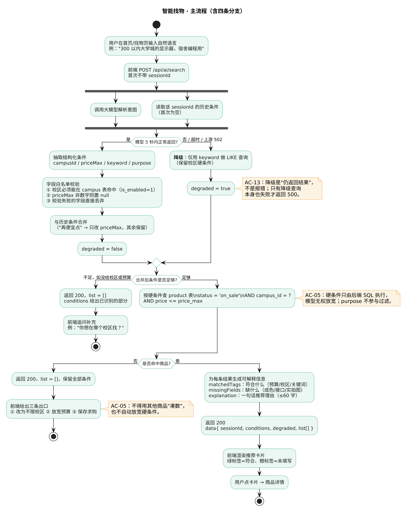
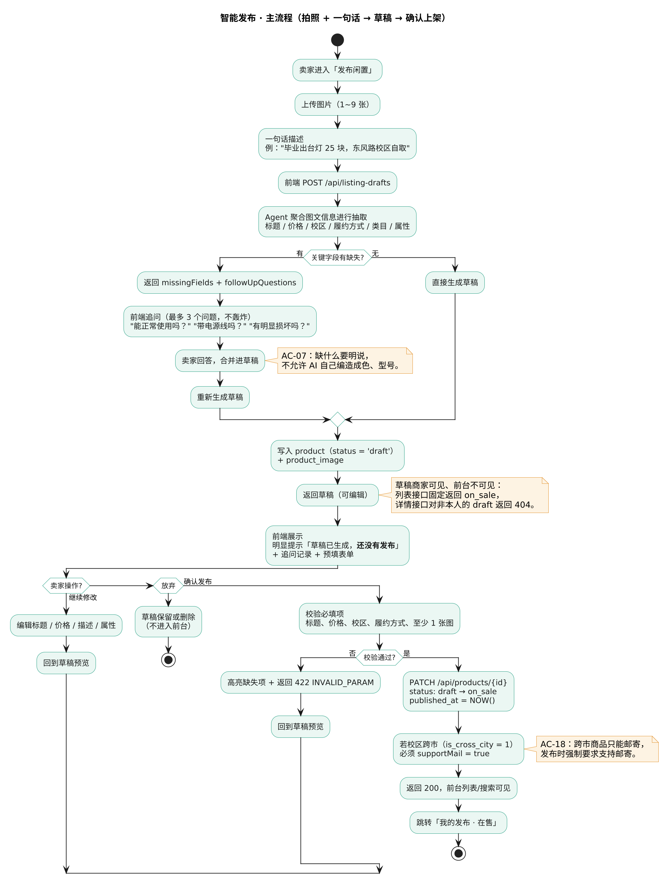
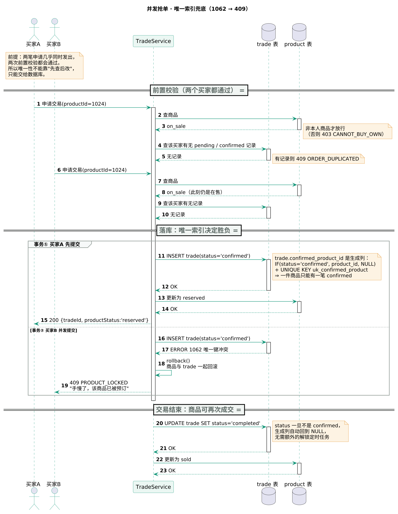
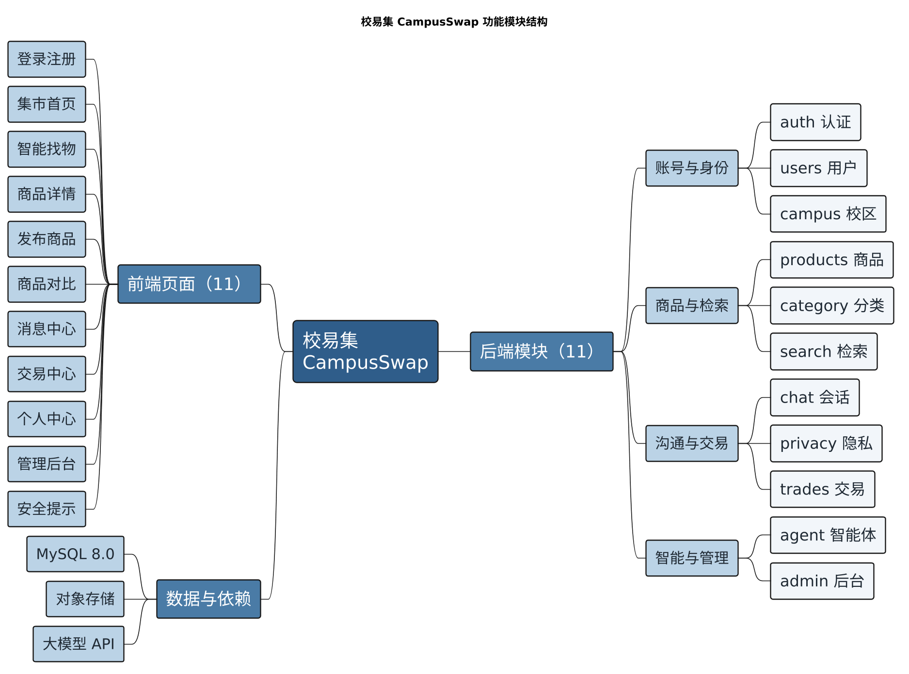

# 校易集 CampusSwap 系统设计说明书

| 项目 | 内容 |
|---|---|
| 文档名称 | 校易集 CampusSwap 系统设计说明书 |
| 文档编号 | CS-DD-002 |
| 版本 | V1.3（正文定稿，8 张图待导入） |
| 编制单位 | 广东工业大学 计算机学院 拾集小队 |
| 编制日期 | 2026-11-21 |
| 依据标准 | GB/T 8567—2006《计算机软件文档编制规范》软件设计说明（SDD） |

### 修订记录

| 版本 | 日期 | 修订人 | 修订内容 |
|---|---|---|---|
| V0.1 | 2026-11-20 | 翁佳华 | 建立章节骨架，完成引言与总体设计 |
| V0.5 | 2026-11-20 | 翁佳华 | 完成模块划分与接口约定章节 |
| V0.9 | 2026-11-20 | 翁佳华 | 完成总体设计、模块设计、接口、数据结构、出错处理、安全保密与变更记录 |
| V1.0 | 2026-11-21 | 翁佳华 | 新增 2.7 非功能性设计、4.3 接口参数摘要、8.2 验收标准追溯；按接口说明书 V1.5 与数据库设计说明书定稿统一交易流程、隐私链路与表清单口径；据《05-原型走查记录》校正 8.2 的 AC 编号、补交易「已中止」状态；修正 C-01 变更理由与金额精度表述 |
| V1.1 | 2026-11-21 | 翁佳华 | 补 5.1 类图章节（原稿以实体说明替代类图，不满足「用类图描述系统结构」的要求）；第 5 章小节顺延为 5.1~5.4，ER 图号相应改为图 5-2 |
| V1.2 | 2026-11-21 | 翁佳华 | 8.2 按需求文档 7.11 节 AC 原文重写（18 条），删除原表误加的 AC-19；更正 AC-01/07/11/12/16 的对应关系；确认限频出自 AC-16，C-05 转为必须实现；关闭 O-04、O-06，新增走查记录 AC 编号需修订的问题 |
| V1.3 | 2026-11-21 | 翁佳华 | 补交易状态的中英文枚举对应（正文用中文、库内用英文，两处需可对照）；统一图占位符格式；输出 PDF 排版版（38 页，含目录） |

---

# 1 引言

## 1.1 编写目的

本文档面向校易集 CampusSwap 系统的开发、测试与验收三方，说明系统的体系结构、模块划分、接口约定、数据结构、出错处理与安全设计，作为后续编码实现与验收测试的直接依据。

本文档的预期读者为：项目组成员（作为开发依据）、课程指导教师与助教（作为设计评审与验收依据）。

本文档承接《校易集 CampusSwap 需求规格说明书》V1.0，不重复叙述需求背景与业务调研结论，仅在设计层面对需求的实现方式作出决策。凡本文档与需求文档存在不一致之处，以本文档的「附录 A 设计变更说明」为准。

## 1.2 项目背景

校易集是面向广东工业大学在校学生的校园二手交易平台，覆盖大学城、东风路、龙洞、番禺、揭阳五个校区。系统以内嵌的智能交易助手为核心差异点：买家可以用自然语言描述用途、预算与校区约束，直接获得真实在售的商品清单与推荐理由；卖家可以用一张照片加一句话生成发布草稿。全流程沟通在平台内完成，不公开手机号与微信号。

系统的核心矛盾来自需求调研的结论：校园二手的供给并不短缺，问题在于**供给的表达成本过高、需求没有被翻译成可执行的查询、交易状态与联系方式缺乏约束**。本设计的所有关键决策，均围绕这三件事展开。

## 1.3 术语与缩写

本文档中出现的缩写在首次使用时给出定义，汇总如下：

| 缩写 / 术语 | 全称 | 定义 |
|---|---|---|
| SDD | Software Design Description | 软件设计说明，即本文档所依据的文档类型 |
| DBDD | Database Design Description | 数据库设计说明，本文档的配套文档 |
| MVP | Minimum Viable Product | 最小可行产品，本项目中指必须交付的 7 个核心模块 |
| UML | Unified Modeling Language | 统一建模语言 |
| ER | Entity-Relationship | 实体—联系模型，用于数据库概念设计 |
| ORM | Object-Relational Mapping | 对象关系映射，将数据库表映射为程序中的类 |
| AC | Acceptance Criteria | 验收标准，本项目共 18 条，编号 AC-01 至 AC-18 |
| CSCI | Computer Software Configuration Item | 计算机软件配置项，本文档中即指校易集系统整体 |
| JWT | JSON Web Token | 一种无状态的令牌认证机制 |
| 硬条件 | — | 由后端 SQL 强制执行、智能体无权放宽的检索条件，本项目指校区、预算上限、分类 |
| 履约方式 | — | 商品成交后的交接方式，分为「校内/跨校区面交」与「跨市邮寄」两种 |
| 降级 | — | 上游服务（大模型）不可用时，系统退回基础可用能力的行为 |
| 生成列 | Generated Column | MySQL 中由表达式自动计算并随行写入的列，本项目用于把「仅在某状态下生效」的字段投影为可建唯一索引的列 |
| 先到先得 | First-Come-First-Served | 本项目交易语义：买家点击立即购买即成交，不设卖家二次确认（见 D-05） |
| 打码 | Masking | 把文本中识别到的手机号、微信号等替换为统一占位符，本项目为写入时执行且不可逆（见 D-06） |

## 1.4 引用文件

| 编号 | 文件名称 | 版本 |
|---|---|---|
| R1 | 校易集 CampusSwap 需求规格说明书 | V1.0（2026-11-08） |
| R2 | 校易集 CampusSwap 数据库设计说明书 | 本文档配套，同步编制 |
| R3 | 校易集 CampusSwap 核心接口设计说明书 | V1.5（2026-11-21） |
| R4 | GB/T 8567—2006 计算机软件文档编制规范 | 2006 |
| R5 | GB/T 9385—2008 计算机软件需求规格说明规范 | 2008 |

## 1.5 设计约束与假设

**约束：**

1. 交付形态为响应式 Web 为主、微信小程序复用同一套 API，两者不重复实现业务逻辑。
2. 开发周期为课程学期内的四轮迭代，团队 7 人，均为在校学生，无全职投入。
3. 不含在线支付与资金托管，所有资金往来在平台外发生。
4. 服务器为单台云服务器，通过 Nginx + Docker Compose 部署，不做多机集群。

**假设：**

1. 校内用户以学号邮箱完成轻量认证，不采集身份证、学生证等敏感证件。
2. 商品图片在开发期存本地目录、部署期存对象存储，单图不超过 5 MB。
3. 大模型服务通过 HTTP 调用外部 API，单次调用超时时间设为 5 秒。
4. 校区信息由后台维护，新增校区不引起代码变更（详见 2.6 决策 D-01）。

---

# 2 总体设计

## 2.1 设计目标与原则

**设计目标：**

1. 在四轮迭代内交付需求文档定义的 7 个 MVP 功能模块；技术实现上拆分为 11 个后端模块与 11 个前端页面（见 3.1），功能范围不因拆分而增减。
2. 智能体的每一项输出均可追溯到数据库中的真实记录，不存在编造的商品。
3. 用户的联系方式在未获双方授权前，任何接口都不返回明文。
4. 新增校区、新增商品分类等运营变更，不引起代码修改。
5. 大模型服务不可用时，系统核心交易链路仍然可用。

**设计原则：**

| 原则 | 含义 | 在本项目中的体现 |
|---|---|---|
| 单一数据源 | 同一业务事实只在一处定义 | 校区以表存储，不在代码中硬编码枚举；商品状态只能由后端状态机变更 |
| 分层解耦 | 表现层不直接访问数据层 | 前端仅调用 REST 接口；智能体与页面共用同一套业务服务 |
| 契约先行 | 接口定义先于实现 | 迭代开始前先定接口契约，前端用 Mock 数据并行开发 |
| 失败可降级 | 任意外部依赖失效不阻断主链路 | 大模型超时退回关键词检索；图片服务失败显示占位图 |
| 最小权限 | 任何角色只获得完成其职责所必需的数据 | 管理员默认不可见聊天内容，需按次授权并留痕 |
| 不可信输入 | 用户输入与模型输出均视为不可信 | 模型输出经白名单校验后才进入 SQL；SQL 全部参数化 |

系统对外提供的功能范围，以及游客、学生用户、管理员三类人员参与者与系统之间的交互关系见图 2-1。智能体服务作为外部系统参与者出现在用例图中，其调用受 4.4 节工具约定的约束。

【图 2-1：系统用例图，见 docs/uml/01-usecase.png】

## 2.2 系统体系结构

系统采用**五层体系结构**，自上而下依次为表现层、接入层、业务服务层、智能体层与数据层。各层职责与依赖方向如下：

| 层次 | 职责 | 主要构成 | 依赖方向 |
|---|---|---|---|
| 表现层 | 页面渲染与用户交互 | Web 前端（Vue 3）、微信小程序 | 只依赖接入层 |
| 接入层 | 路由、鉴权、参数校验、统一返回 | Nginx、FastAPI 路由与中间件 | 依赖业务服务层 |
| 业务服务层 | 实现全部业务规则与状态流转 | 11 个后端模块 | 依赖数据层 |
| 智能体层 | 意图理解、条件抽取、工具编排 | 大模型 API + 工具层 | **只通过业务服务层访问数据** |
| 数据层 | 持久化与检索 | MySQL 8.0、对象存储 | 无 |

**关键结构约束：** 智能体层与表现层是**平级的两个入口**，二者调用同一套业务服务，不存在「智能体直连数据库」的旁路。这一约束保证了无论用户是通过页面筛选还是自然语言检索，得到的商品、价格、状态都来自同一份数据与同一套规则。

```
                    ┌──────────────────────────────────┐
                    │           表现层                  │
                    │   Web 前端       微信小程序        │
                    └────────────┬─────────────────────┘
                                 │ HTTPS / JSON
                    ┌────────────▼─────────────────────┐
                    │           接入层                  │
                    │  Nginx → FastAPI 路由 / 鉴权 / 校验 │
                    └───────┬──────────────┬───────────┘
                            │              │
              ┌─────────────▼───┐    ┌─────▼──────────────┐
              │   业务服务层      │◄───┤     智能体层        │
              │  11 个业务模块    │    │ 意图理解 / 条件抽取  │
              │                  │    │ 工具调用 / 结果解释  │
              └─────────────┬───┘    └────────────────────┘
                            │         （工具回调经业务服务层，
                            │           不直接访问数据层）
                    ┌───────▼──────────────────────────┐
                    │            数据层                 │
                    │      MySQL 8.0    对象存储        │
                    └──────────────────────────────────┘
```

【图 2-2：系统分层体系结构图，见 docs/uml/00-architecture.png】

## 2.3 技术选型与理由

| 层次 | 选型 | 选择理由 | 被否决的方案及原因 |
|---|---|---|---|
| 前端 | Vue 3 + TypeScript + Vite | 电脑答辩与手机体验均可覆盖；团队上手成本低；组件生态成熟 | React：团队无使用经验，学习成本换取不到额外收益 |
| UI 组件 | Element Plus | 表单、表格、弹窗开箱可用，后台管理页节省时间 | 自研组件库：课程周期内投入产出比低 |
| 后端 | Python 3.10 + FastAPI | 与智能体工具调用同语言；自动生成 OpenAPI 文档，契约先行成本低 | Spring Boot：团队有 Java 基础，但会引入智能体侧的语言割裂 |
| ORM | SQLAlchemy 2.0 | 支持生成列等 MySQL 特性映射，事务控制清晰 | MyBatis：需额外维护 XML，迭代速度快时不划算 |
| 数据库 | MySQL 8.0 | 事务能力用于交易并发控制；生成列 + 唯一索引可承担并发唯一性约束 | PostgreSQL：部署与团队熟悉度不如 MySQL |
| 实时消息 | WebSocket | 聊天需服务端主动推送；鉴权在连接建立时完成 | 轮询：消息延迟与服务器压力均不可接受 |
| 智能体 | 外部大模型 API + 自建工具层 | 编排逻辑与工具定义以代码形式纳入版本库，可评审、可回归；运行时不依赖第三方平台上线的可用性 | 可视化编排平台：调试直观，但编排配置游离于代码仓库之外，无法随代码一起做版本管理与评审，且演示环境依赖平台账号 |
| 部署 | 云服务器 + Nginx + Docker Compose | 一次配置可复现，避免「只有一个人会部署」 | 手动部署：环境不可复现，排障成本高 |

> **说明：** 需求文档 V1.0 中智能体平台曾选型为可视化编排平台，本次调整为「自建工具层 + 直连大模型 API」。调整原因有两条：一是编排配置与提示词若放在第三方平台，无法纳入版本库随代码一起评审与回滚；二是答辩与验收现场依赖外部平台可用性，风险不可控。业务数据无论采用哪种方案都不出库，本条变更不涉及数据边界。该变更已记录于附录 A。

## 2.4 部署视图

系统部署于单台云服务器，通过 Docker Compose 编排三个容器：Nginx（反向代理与静态资源）、FastAPI 应用、MySQL。对象存储与大模型服务为外部依赖节点。

【图 2-3：部署架构图，见 docs/uml/09-deployment.png】

部署要点：

1. Nginx 对外提供 443 端口，负责 HTTPS 终止、静态资源分发与 `/api` 反向代理。
2. 应用容器不直接暴露端口，仅在内网被 Nginx 访问。
3. MySQL 仅监听容器内网，不对公网开放；数据库账号按最小权限分配。
4. 密钥、数据库口令通过环境变量注入，`.env` 文件不入版本库。
5. 开发环境与生产环境使用同一套 Compose 配置，仅环境变量不同。

## 2.5 运行逻辑

系统对外呈现四条主运行链路，其余功能均为这四条链路的附属操作。

**链路一：自然语言找物（核心链路）**

```
用户输入自然语言
  → 接入层校验登录态与参数
  → 智能体层抽取结构化条件（校区 / 预算上限 / 分类 / 关键词）
  → 判断关键条件是否齐全 ── 不齐 ──→ 生成追问 → 回到用户输入
  → 条件齐全 → 调用检索工具
  → 业务服务层按硬条件执行参数化查询（状态只取在售，不推荐买不到的）
  → 有结果 ──→ 组装推荐卡片（标注符合项与缺失项）→ 返回前端
  → 无结果 ──→ 明确提示，不编造，不放宽硬条件 → 提供保存求购入口
```



<p align="center">图 2-4　智能找物活动图</p>
【图 2-5：智能找物时序图，见 docs/uml/05-sequence-agent.png】

**链路二：智能发布**

```
用户上传图片 + 一句话描述
  → 智能体层识别商品类别与已知属性
  → 对照该类目的必填属性，生成追问（成色 / 配件 / 是否有损坏）
  → 汇总为发布草稿（不直接入库）
  → 用户在前端修改并确认
  → 业务服务层校验后写入，状态置为 on_sale
```



<p align="center">图 2-6　智能发布活动图</p>

**链路三：沟通与交易**

```
买家在详情页点击「立即购买」→ 校验（在售 / 非本人 / 未被拉黑）
  → 交易创建即已确认，数据库唯一索引裁决并发 → 仅一人成功，另一人收到「已被预订」
  → 商品转 reserved → 进入会话沟通交接（敏感信息写入即打码）
  → 需要联系方式 → 一方主动填写并提交交换申请 → 另一方同意 → 按会话返回
  → 线下交接 → 双方确认完成 → 商品转 sold
```

> **说明：** 交易不要求先建立会话，买家可直接下单。沟通是成交后的交接手段，不是成交的前置条件——这与「先到先得」的语义一致，也避免了「必须先聊两句才能买」这种人为门槛。



<p align="center">图 2-7　并发抢单时序图</p>
【图 2-8：并发抢单协作图，见 docs/uml/07-collaboration-trade.png】
【图 2-9：商品与交易状态机，见 docs/uml/08-state-product-trade.png】

**链路四：后台管理**

```
管理员登录 → 按角色进入后台
  → 用户管理 / 校区管理 / 商品下架 / 举报处理
  → 处理举报需查看聊天时 → 提交按次授权申请（绑定举报单、限定时间窗、24 小时失效）
  → 查看行为写入审计日志
```

## 2.6 全局设计决策

以下 10 项决策影响系统多个模块，单独列出并说明理由与代价。这是本设计的核心，模块设计章节不再重复论证。

| 编号 | 决策 | 理由 | 代价 / 风险 | 关联 AC |
|---|---|---|---|---|
| D-01 | 校区独立成表，不作代码枚举 | 新增校区只需后台加一条记录，前端筛选器与发布表单自动出现新选项，不引起发版 | 每次展示校区名称需 join 或缓存，读取成本略增 | AC-17 |
| D-02 | 智能体与页面共用业务服务，智能体不直连数据库 | 保证同一商品的字段、价格、状态来自同一份数据与同一套规则，避免「页面显示在售、AI 说已卖出」这类矛盾 | 两者状态过滤范围可以有别（列表含已预订、检索仅在售），差异必须在文档中写明，否则会被误判为不一致 | AC-06 |
| D-03 | 硬条件（校区 / 预算 / 分类）由后端 SQL 执行，模型输出经白名单校验 | 模型存在幻觉，一旦放宽条件会返回用户明确排除的商品，属于可信度致命伤 | 条件抽取错误时表现为「搜不到」，需在追问中兜底 | AC-02 AC-05 |
| D-04 | 交易并发唯一性交给数据库：生成列 + 唯一索引 + 捕获唯一键冲突 | 把并发正确性交给数据库的原子约束，而非应用层的「先查后改」，避免竞态窗口；正确性由一条 INSERT 保证，不存在「商品锁定但交易未创建」的中间态 | 依赖 MySQL 生成列特性，迁移到其他数据库需改写；并发失败方只能看到「已被预订」，无法区分是被谁抢先 | AC-10 |
| D-05 | 交易采用先到先得，不设卖家二次确认 | 减少一个接口、一个页面状态与一组通知，在课程周期内更易做扎实；「多人同时下单只成一单」可直接演示 | 卖家无法挑选买家，存在被恶意下单锁货的可能，只能靠取消交易释放；`pending`/`rejected` 两个状态值成为死值（保留在表中以备后续恢复） | AC-10 |
| D-06 | 聊天记录中识别到的联系方式打码后即丢弃，原文不落库 | 数据最小化的彻底实现：即使数据库泄露，也无法还原任何联系方式 | 打码不可逆，误伤无法恢复；举报场景下无法还原原文作为证据 | AC-15 |
| D-07 | 联系方式交换走独立表，由用户主动填写并加密存储 | 与 D-06 配合，使「原文不落库」与「同意后可见」同时成立；且号码是用户显式授权提供的，而非被动抓取 | 用户需多一步填写动作 | AC-15 |
| D-08 | 聊天以会话（商品 + 买家 + 卖家）为单位，而非以用户对为单位 | 同一对用户可能就不同商品产生多个会话，按用户对聚合会混淆上下文，且无法按商品做权限校验 | 前端需在会话列表中展示关联商品卡片 | AC-09 |
| D-09 | 商品状态只能由后端专用接口驱动，客户端不可直接写状态字段 | 防止客户端伪造状态导致「已售出商品重新上架」或「绕过预订直接成交」 | 接口数量增加，每个状态变更一个端点 | AC-11 AC-12 |
| D-10 | 大模型调用失败时降级为关键词 + 硬条件检索，不直接报错 | 智能体是增强能力而非唯一入口，降级后主链路仍可用 | 降级结果的推荐解释质量下降，需在界面明示「已降级」 | AC-13 |

> **D-05 的连带影响：** 该决策不是纯粹的技术选择，它改变了产品语义。数据库设计说明书中「卖家接受申请 → 事务内加锁」的并发章节随之作废，改为「买家下单直接插入已确认交易，由唯一索引兜底」；原型详情页按钮文案由「申请购买」改为「立即购买」，交易中心不再提供卖家确认入口。三处必须同时生效，不得只改代码不改文档。

## 2.7 非功能性设计

需求文档第 10 章提出的非功能需求，在设计层的响应如下。**本表不含任何未经实测的性能数字**，凡未压测项均标注实测计划。

| 属性 | 需求侧要求 | 设计响应 | 当前状态 |
|---|---|---|---|
| 性能 | 集市列表与商品详情在校园网络下可接受 | 列表查询固定过滤 `status = 'on_sale'` 并对「状态 + 校区 + 发布时间」走组合索引；图片走对象存储 CDN，不进应用服务器；接口分页上限 50 条，避免单次拉全表 | 未压测，不给具体响应时间（见 O-03） |
| 并发正确性 | 同一商品不得被两人同时买下 | 由生成列 + 唯一索引在数据库层裁决，应用捕获唯一键冲突转 409（D-04） | 已设计，待双线程用例验证 |
| 可用性 | 大模型不可用时主链路仍可用 | 智能检索降级为关键词 + 硬条件检索，响应体标记已降级；图片失败显示占位图；WebSocket 断开降为轮询（6.2） | 降级逻辑待编码实现（C-05） |
| 数据一致性 | 交易与商品状态不得出现中间态 | 状态变更由后端专用接口驱动（D-09）；多表写入置于同一事务 | 已设计 |
| 安全 | 联系方式未授权不可见 | 原文不落库、打码不可逆、交换号码加密存储且可撤回（D-06 / D-07） | 已设计 |
| 兼容性 | 电脑与手机均可使用 | 前端响应式布局，最小支持宽度 375px；API 与小程序共用，不重复实现业务逻辑 | 需在真机验证 |
| 可维护性 | 运营变更不引起发版 | 校区、分类均为表数据（D-01）；接口契约由 FastAPI 自动生成 OpenAPI 文档 | 已设计 |
| 可移植性 | 便于本地复现与部署 | Docker Compose 三容器编排，开发与生产同一套配置，仅环境变量不同（2.4） | 已设计 |

**关于性能指标的说明：** 本项目不对响应时间作数值承诺。单台云服务器、无压测数据的前提下，任何「P95 < 200ms」之类的写法都是凭空编造，评审时无法自证，实现时也无法验收。文档改为承诺「可验证的结构性措施」（索引、分页、CDN、降级），并在迭代四补压测后回填实测值。

---

# 3 模块设计

> 本章按「模块 → 职责 → 内部处理流程 → 接口 → 异常」的层次展开，越往后越具体。各模块的流程图与时序图在对应小节引用。

## 3.1 模块划分总览

**后端模块（11 个）：**

| 序号 | 模块 | 职责 | 主要依赖 |
|---|---|---|---|
| 1 | auth | 注册、登录、JWT 签发与校验、校内身份认证 | users |
| 2 | users | 用户资料、校区归属、隐私设置 | campus |
| 3 | campus | 校区配置的增删改查与启用状态 | 无 |
| 4 | products | 商品发布、编辑、状态流转、图片、收藏 | users / campus / category |
| 5 | category | 分类与类目属性模板 | 无 |
| 6 | search | 结构化条件检索与规则排序 | products |
| 7 | agent | 意图理解、条件抽取、工具编排、结果解释 | search / products / category |
| 8 | chat | 会话创建、消息收发、WebSocket 推送 | users / products |
| 9 | privacy | 敏感信息识别与打码、联系方式交换、拉黑、举报 | chat / users |
| 10 | trades | 交易创建、状态流转、并发裁决 | products / users |
| 11 | admin | 后台管理、举报处理、校区维护、审计日志 | 全部 |

> **与需求文档的对应说明：** 需求文档的 7 个 MVP 功能模块是业务视角，本表是后端技术视角，两者不是一对一关系。本表将需求文档商品模块中的 `category`（分类与类目属性模板）与 `search`（结构化检索与排序）拆出为独立模块，理由是二者被智能体与页面同时复用，合并进商品模块会造成职责交叉。需求文档中的 `needs`（求购）属扩展项，MVP 阶段不单独建模块，其草稿能力由智能体的 `save_purchase_need_draft` 工具承担，正式实现排在第四轮迭代。合计 11 个后端模块，功能范围与 7 个 MVP 模块一致。

**前端页面（11 个）：** 登录注册、首页/集市、智能找物、商品详情、发布商品、商品对比、消息中心、交易中心、个人中心、管理后台、安全提示。



<p align="center">图 3-1　功能模块结构图</p>

## 3.2 账号与认证模块（auth / users / campus）

**职责：** 完成注册、登录、令牌签发与校验、校内身份认证标记、校区归属维护。

**处理流程：**

1. 注册时校验学号邮箱格式，通过邮箱验证码确认归属，认证状态置为已验证；邮箱以哈希形式存储用于登录与去重，不保存明文，对外只暴露「已验证」标记。
2. 登录成功后签发 JWT，载荷仅含用户 ID 与角色，不含任何个人信息。
3. 每个受保护接口通过依赖注入解析令牌，校验失败统一返回 401。
4. 校区为必填单选，取值来自 `campus` 表中 `is_enabled = 1` 的记录。

**异常处理：** 邮箱验证码错误 → 400；令牌过期 → 401 并提示重新登录；校区 ID 不存在或已停用 → 400。

**设计要点：** 用户资料与认证信息分离存储，认证状态是布尔标记而非证件数据，即使数据库泄露也无法还原任何身份信息。

## 3.3 商品集市模块（products / category）

**职责：** 商品发布、编辑、下架、状态流转、多图管理、收藏。

**处理流程：**

1. 发布时校验必填项（标题、价格、分类、校区、至少一张图），价格非负，校区必须为启用状态。
2. 图片先上传获得 URL，再随商品信息一并提交；图片表以 `sort_no` 维护顺序，`sort_no = 0` 为主图。
3. 列表查询过滤 `status IN ('on_sale', 'reserved')`，校区为硬条件，跨市场景额外校验「支持邮寄」标记。**已预订商品必须出现在列表中并置灰**，不能直接过滤掉。

> **为什么列表展示已预订，而智能检索不展示（决策 C-08）：**
>
> 先到先得下商品被抢走后，如果它直接从集市列表消失，用户会认为「刚才看到的东西凭空没了」，实际是自己下手慢了。展示并标注「已被预订」既解释了消失，也构成平台真有交易的信任信号。所以**列表返回在售 + 已预订，已预订卡片置灰、购买按钮禁用**。
>
> 智能检索不同：它的产品语义是「帮我找能买的」。把买不到的商品混进推荐结果，用户点进去全部置灰，是纯粹的噪音。所以**检索只返回在售**。
>
> 两个入口的状态过滤范围不同，这不是实现分歧，而是业务目的不同：
>
> | 入口 | 用户意图 | 状态范围 |
> |---|---|---|
> | 集市列表 | 浏览库存，了解市场 | 在售 + 已预订（后者置灰） |
> | 智能检索 | 帮我找能买的 | 仅在售 |
>
> 因此 D-02 所说的「两个入口一致」，指的是**数据来源、字段取值、硬条件执行方式一致**——同一件商品在两个入口看到的标题、价格、状态必须来自同一条记录；不是要求两个入口返回完全相同的集合。这条区分要在接口文档与前端类型里写清楚，否则前端会按「列表有什么检索就该有什么」去写。同理，已预订商品在智能检索的「无命中」分支中不出现，不能把「有已预订商品」当作有结果返回。
4. 状态流转只允许：草稿→在售、在售→已预订、已预订→已售出、在售→已下架，其余组合由后端拒绝。**已预订状态下不允许直接下架**，须先取消交易（理由见 3.7 联动规则）。

**异常处理：** 必填项缺失 → 400 并指明字段；修改他人商品 → 403；商品不存在 → 404。

## 3.4 智能找物模块（agent / search）

**职责：** 把自然语言翻译为可执行的结构化查询，返回真实商品并解释推荐依据。

**分层处理流程：**

1. **意图识别层：** 判断输入属于找物、发布、闲聊中的哪一类。
2. **条件抽取层：** 输出固定 JSON 结构，字段为校区、预算上限、分类、关键词、用途描述。
3. **校验层：** 校区名必须在校区表中命中且启用；预算必须为数字且非负；分类必须存在于分类表。任一项校验失败即丢弃该条件，不进入 SQL。
4. **会话合并层：** 与同一会话中已确认的条件合并，仅覆盖用户本轮明确提到的字段。此层依赖会话标识，接口需携带 `sessionId`（见附录 A C-04）。
5. **检索层：** 按硬条件执行参数化查询，结果按「分类精确匹配 → 关键词命中 → 偏好满足 → 信息完整度 → 发布时间」排序。
6. **解释层：** 为每件商品标注「符合什么」与「缺什么」，不输出无依据的匹配度百分比。

**异常处理：** 关键条件缺失 → 追问，不猜测；无结果 → 明确提示并提供保存求购入口；模型超时或异常 → 降级为关键词检索并在响应中标记已降级（决策 D-10）。

本模块的时序图见图 2-5，活动图见图 2-4（二者在 2.5 节首次出现，此处不重复编号）。

## 3.5 智能发布模块（agent / products）

**职责：** 从图片与一句话描述生成可编辑的发布草稿。

**处理流程：** 识别商品类别 → 读取该类目的必填属性模板 → 比对已知信息 → 生成追问 → 汇总为草稿（**不入库**）→ 用户确认后走正常发布流程。

**设计要点：** 草稿与正式商品严格分离，模型生成的任何内容在用户确认前都不进入商品表，避免「AI 自动发布」导致虚假信息。

## 3.6 站内沟通与隐私模块（chat / privacy）

**职责：** 会话管理、消息收发、敏感信息打码、联系方式交换、拉黑与举报。

**分层处理流程：**

1. 建立会话时校验：商品处于**在售或已预订**状态（成交后双方仍需沟通交接细节，若只允许在售，交易一成功会话就无法建立）、非本人商品、双方未被拉黑。
2. 消息写入前执行敏感信息识别，命中的文本替换为统一占位符，**原文不保存**（决策 D-06）。
3. 消息通过 WebSocket 推送，连接建立时完成鉴权，仅会话参与者可收发。
4. 联系方式交换走独立表：申请方填写、被申请方同意后，按会话单独返回明文；任一方可随时关闭，关闭后立即失效。
5. 拉黑即时生效，被拉黑方的消息发送返回失败。

**异常处理：** 非会话参与者读取 → 403；重复交换申请 → 409；被拉黑发送 → 403 并提示。

## 3.7 交易模块（trades）

**职责：** 交易创建、状态流转、并发唯一性裁决。

**并发设计（本模块核心）：** 买家点击立即购买时，不做「先查后改」的判断，而是直接插入一条已确认状态的交易记录。数据库对「已确认交易的关联商品」建立唯一约束，同一商品第二次插入必然触发唯一键冲突，应用捕获后返回「商品已被预订」。唯一性由数据库的原子约束保证，不存在竞态窗口（决策 D-04）。

**状态流转：** 在先到先得的语义下，交易创建即处于「已确认」，不存在「待确认」这一环。六个状态值在数据库中统一以英文枚举存储，本文档正文用中文表述，两者对应关系为：已确认 `confirmed`、已完成 `completed`、已取消 `cancelled`、已中止 `aborted`、待确认 `pending`、已拒绝 `rejected`（后两个本期不产生）。允许的流转只有三条：

| 起始 | 目标 | 触发者 | 含义 |
|---|---|---|---|
| 已确认 | 已完成 | 双方各自确认 | 交接完成，商品转已售出 |
| 已确认 | 已取消 | 买家或卖家主动取消 | 任一方反悔，商品回到在售 |
| 已确认 | 已中止 | 系统或管理员 | 超过约定期限仍未完成交接，或成交后被判定为违规 |

**「已取消」与「已中止」必须分开，不能合并成一个状态。** 取消是双方自愿的行为，不影响任何一方的信用；中止是外部判定的结果，需要在用户记录里留痕。原型交易中心的五档筛选（全部 / 已确认 / 已完成 / 已取消 / 已中止）就建立在这个区分上。已完成不可逆。

并发失败的一方在插入阶段即被数据库拒绝，库中不会存在该商品的第二条交易记录，因此无需「把其余申请置为失效」这类补偿操作——这正是选择数据库约束而非应用层判断的直接收益。`pending`（待确认）、`rejected`（已拒绝）两个状态值在数据库中保留，本期不产生，用于后续若恢复「卖家二次确认」流程时无需变更表结构（决策 D-05）。

**异常处理：** 抢占失败 → 409；购买自己商品 → 403；商品非在售 → 404；重复提交 → 409。

**与商品状态的联动规则：** 交易创建成功时商品转「已预订」；双方确认完成时转「已售出」；交易被取消时商品回到「在售」，若此时商品已被卖家下架，则不再回滚状态。**商品处于「已预订」时，卖家不得直接下架，须先取消交易**——否则会出现「商品已下架但交易仍为已确认」的悬空态。

本模块的时序图见图 2-7，协作图见图 2-8。

## 3.8 后台管理模块（admin）

**职责：** 用户管理、校区维护、商品下架、举报处理、审计。

**处理流程：** 管理员默认不可读取任何聊天内容。处理举报需查看聊天时，必须提交授权申请（绑定举报单、限定时间窗、24 小时失效），读取时逐条写入审计日志。授权过期无需后台任务，查询时判断有效期即可。

**查看范围的边界（重要）：** 授权后可读的仅是**已打码的消息内容**。由于聊天原文在写入时即被替换、库中不存在副本（D-06），管理员看到的内容与普通用户看到的一致，取证价值仅限于对话语境与行为判断，不包含任何联系方式原文。若举报情形确需号码作为证据，只能走「被举报方主动提交」或「依法调取」两条路径，系统内不存在第三条。这一限制是有意设计的，不是实现缺陷——它同时构成了对管理员权限的硬性约束（关联 AC-15）。

## 3.9 前端页面设计

前端 11 个页面的布局、交互与状态定义见《校易集 CampusSwap 原型设计说明》及原型在线链接，本节仅说明与后端设计的对应关系：

| 页面 | 依赖的主要接口 | 必须实现的异常态 |
|---|---|---|
| 登录注册 | 认证接口、校区列表 | 校验失败、令牌过期 |
| 首页/集市 | 商品列表、校区列表 | 加载中、空结果、接口失败 |
| 智能找物 | 智能检索、会话续接 | 追问、无结果、降级、模型不可用 |
| 商品详情 | 商品详情、收藏、发起咨询 | 商品已售出、已下架 |
| 发布商品 | 图片上传、草稿、发布 | 必填校验、上传失败 |
| 消息中心 | 会话列表、消息收发、交换申请 | 连接断开、发送失败 |
| 交易中心 | 交易创建、状态查询 | 抢占失败、重复提交 |
| 后台管理 | 管理接口、授权申请 | 无权限、授权过期 |

其余三页（商品对比、个人中心、安全提示）以组合调用上表接口为主，不新增独立接口：商品对比复用商品详情与对比工具，个人中心复用资料与收藏接口，安全提示为纯静态内容。

---

# 4 接口设计

## 4.1 接口规范

1. 风格为 RESTful，资源用复数名词，动作用 HTTP 方法表达。
2. 统一响应外壳包含 `code`、`msg`、`data`、`bizCode`、`traceId` 五个字段，`code` 与 HTTP 状态码保持一致。
3. 字段对外使用小驼峰，数据库使用下划线，由 ORM 别名映射。
4. 分页参数 `page` 从 1 开始，`pageSize` 默认 20、上限 50。
5. 金额在数据库中以 `DECIMAL` 存储，程序内以定点小数参与计算，禁止浮点；接口输出为两位小数的字符串（如 `"1800.00"`），由前端直接展示，避免 JSON 数字不保留尾零导致「1800.0」与文档承诺不一致。
6. 时间在数据库内统一存储为**无时区的 UTC 值**（`DATETIME`），接口输出转换为带 `Z` 或 `+08:00` 偏移的 ISO 8601 字符串。不在库内存带时区的时间，以免不同驱动对时区的解释不一致。

## 4.2 核心接口清单

完整定义见《核心接口设计说明书》V1.5，本文档仅列出与设计决策直接相关的核心接口：

| 接口 | 方法 | 设计要点 |
|---|---|---|
| 校区列表 | GET | 只返回启用状态校区，前端筛选器与发布表单共用 |
| 商品列表 | GET | 校区为硬条件，返回在售与已预订（后者置灰），跨市场景校验邮寄标记（C-08） |
| 智能检索 | POST | 须带会话标识以支持多轮条件继承（**设计要求，接口说明书 V1.5 仍未提供此参数，见附录 A C-04**） |
| 立即购买 | POST | 并发唯一性由数据库唯一约束裁决（D-04 / D-05） |
| 消息列表 | GET | 以会话为单位，校验参与者身份 |
| 联系方式交换 | POST | 双方同意后才返回明文，可随时关闭 |
| 举报 | POST | 举报是管理员查看聊天的唯一入口 |

## 4.3 核心接口参数摘要

下表用于评审时快速判断接口是否可实现，字段为摘要而非完整定义。凡本文档与接口说明书不一致处，以本文档的附录 A 为准（附录 A 记录了须执行的变更）。

| 接口 | 关键入参 | 关键出参 | 主要错误码 |
|---|---|---|---|
| 智能检索 | `query`（自然语言）、`sessionId`（首次为空）、`campusId` | 已解析条件、`missingFields`（待追问字段）、商品卡片列表（每项含 `matchedTags`、`missingFields`、`explanation`）、`degraded` 降级标记 | 400 参数非法、502/504 上游异常（降级后返回 200 + `degraded=true`） |
| 商品列表 | `campusId`、`categoryId`、`priceMax`、`keyword`、`status`（可选，默认在售+已预订）、`page`、`pageSize` | 分页商品卡片（含状态）、总数 | 400 参数非法 |
| 立即购买 | `productId` | 交易 ID、商品状态 | 403 购买自己商品、404 商品非在售、409 已被预订 / 重复提交 |
| 消息列表 | `conversationId`、`page` | 消息列表（已打码）、发送者、时间 | 403 非会话参与者 |
| 联系方式交换 | `conversationId`、`phoneEnc`（申请方填写） | 交换状态、授权后返回明文 | 403 非会话参与者、409 重复申请且未关闭 |
| 举报 | `targetType`、`targetId`、`reason`、`evidence` | 举报单号 | 400 参数非法、404 目标不存在 |

> **说明：** 「降级后返回 200 + `degraded=true`」是本设计的要求。接口说明书 V1.5 目前在大模型失败时直接抛 502/504，与 AC-13 的验收场景冲突，须按此修正（附录 A C-05）。

## 4.4 智能体工具接口约定

智能体通过 6 个工具访问业务能力，工具参数使用固定 JSON 结构强校验，返回值只包含业务字段，**不包含任何联系方式字段**。

| 工具 | 作用 |
|---|---|
| search_products | 按结构化条件检索商品 |
| get_product_detail | 获取商品完整信息 |
| compare_products | 读取多件商品并整理可比较字段 |
| get_category_schema | 查询某类目的必填属性模板 |
| create_listing_draft | 创建发布草稿 |
| save_purchase_need_draft | 保存求购条件 |

详细参数定义见《智能体接口约定》。

## 4.5 外部接口

| 外部服务 | 用途 | 失败处理 |
|---|---|---|
| 大模型 API | 意图理解与条件抽取 | 超时 5 秒，失败降级为关键词检索 |
| 对象存储 | 商品图片存储 | 上传失败提示重试，不影响其他功能 |
| 邮件服务 | 学号邮箱验证码 | 失败提示稍后重试，不阻断浏览 |

---

# 5 数据结构设计

> 本章仅给出与系统设计相关的实体关系概要。完整的表结构、字段定义、索引与约束见《数据库设计说明书》，本章不重复列表，以避免两份文档出现不一致。

## 5.1 类图（对象结构）

类图描述系统在代码层面的静态结构：实体类与库表一一对应，服务类承载业务规则，工具类被智能体调用。**类图与 ER 图不能互相替代**——ER 图只描述库表的字段与关联，类图还要表达方法归属、服务与实体的依赖方向，以及智能体工具层的边界。

类的划分遵循三条规则：

1. **实体类只映射表结构，不含业务规则**。`Product`、`Trade`、`Message` 等类只声明字段与基础校验，状态的合法流转由服务类判定，而不是散落在实体里。
2. **服务类是唯一可以修改实体状态的角色**。`TradeService` 负责下单与并发裁决，`ProductService` 负责状态机校验，`PrivacyService` 负责打码与授权解密。这条约束对应 2.1 的「单一数据源」原则。
3. **智能体工具层是一个薄适配层**。`AgentToolGateway` 把大模型的工具调用翻译成对服务类的方法调用，自身不持有业务逻辑，与 D-02「智能体与页面共用业务服务」一致。

【图 5-1：系统类图，见 docs/uml/04-class.png】

## 5.2 实体关系概览

系统共 **16 张数据表**，按职责分为四组。**字段定义、索引与 DDL 以《数据库设计说明书》的关系模型章节为准**，本节只列出表清单与分组意图，不重复列字段，以免两份文档出现不一致。

| 序号 | 表名 | 含义 | 分组 |
|---|---|---|---|
| 1 | `campus` | 校区配置（含启用与跨市标记） | 基础配置 |
| 2 | `category` | 商品分类与类目属性模板 | 基础配置 |
| 3 | `user` | 账号、认证标记、角色 | 用户与身份 |
| 4 | `user_profile` | 昵称、头像、校区归属、隐私设置 | 用户与身份 |
| 5 | `product` | 商品主体、状态、价格、类目属性 | 商品与检索 |
| 6 | `product_image` | 商品图片与排序（`sort_no = 0` 为主图） | 商品与检索 |
| 7 | `favorite` | 收藏关系 | 商品与检索 |
| 8 | `conversation` | 会话（商品 + 买家 + 卖家） | 交互与交易 |
| 9 | `message` | 消息（内容已打码，原文不存） | 交互与交易 |
| 10 | `contact_exchange` | 联系方式交换申请与授权状态 | 交互与交易 |
| 11 | `block` | 拉黑关系 | 交互与交易 |
| 12 | `trade` | 交易与状态流转 | 交互与交易 |
| 13 | `report` | 举报单 | 交互与交易 |
| 14 | `chat_access_grant` | 管理员查看聊天的按次授权 | 交互与交易 |
| 15 | `admin_audit_log` | 管理操作审计日志 | 交互与交易 |
| 16 | `agent_session` | 智能体会话与已确认条件 | 交互与交易 |

**关于表数量的说明：** 需求文档的「14 个实体」是概念模型层面的核心实体数，本设计的 16 张表是在概念模型基础上补充了 `chat_access_grant`（授权留痕）与 `agent_session`（多轮条件继承）两张支撑表。三者关系为：概念实体 14 → 逻辑表 16，不存在第 17 张表。此前沟通中出现的「17 张」为口径误记，本文档以此表为准。

【图 5-2：实体关系图（ER），见 docs/uml/10-er.png】

> **命名注意：** `user` 与 MySQL 内置函数 `USER()` 同名，虽非保留字，但 DDL 与 SQL 中统一用反引号包裹，避免歧义。此项须在两份文档的 DDL 中保持一致。

## 5.3 核心实体说明

| 实体 | 关键设计点 |
|---|---|
| 校区 | 独立成表，含启用标记与是否跨市标记，后台可增删（D-01） |
| 商品 | 含校区、是否支持邮寄、状态、类目属性（以 JSON 存储，避免为每个类目建表） |
| 消息 | 内容写入时即完成打码，库中不存在联系方式原文（D-06） |
| 会话 | 由商品、买家、卖家三者唯一确定（D-08） |
| 交易 | 含生成列以承担「同一商品仅一笔已确认交易」的唯一约束（D-04） |
| 联系方式交换 | 号码加密存储，按会话单独返回，可随时关闭（D-07） |
| 查看授权 | 绑定举报单、限定时间窗、带失效时间，读取行为写审计日志 |

## 5.4 关键约束

1. 「用户 + 商品」在收藏表中唯一。
2. 「拉黑人 + 被拉黑人」在拉黑表中唯一。
3. 同一商品最多存在一笔已确认交易：以 `product_id` 生成列 + 唯一索引实现（D-04）。
4. 同一举报单对同一管理员最多一条**生效中**的查看授权：以生成列把「状态为 active 时才取 `report_id`」投影为索引列，使过期授权不占用唯一位，管理员在授权失效后可再次申请。**若直接把 `status` 纳入唯一索引，过期记录会永久占位，导致管理员再也无法申请**，这是必须避开的写法。
5. 商品价格非负。
6. 交易状态只能按规定路径变更，由后端专用接口驱动（D-09）。

---

# 6 出错处理设计

## 6.1 错误码体系

`code` 与 HTTP 状态码保持一致，`bizCode` 用于前端做差异化处理。

| 状态码 | 含义 | 典型场景 | 前端处理 |
|---|---|---|---|
| 400 | 参数不合法 | 必填项缺失、格式错误 | 高亮对应输入项 |
| 401 | 未认证 | 未登录、令牌失效 | 跳转登录 |
| 403 | 无权限 | 修改他人商品、非会话参与者 | 提示无权限 |
| 404 | 资源不存在 | 商品已删除、用户不存在 | 提示并刷新 |
| 409 | 状态冲突 | 商品已被预订、重复申请 | 弹窗展示提示文案 |
| 429 | 请求过频 | 短时间重复提交（**本期不启用，错误码预留**；若 C-05 采纳简易限频则启用） | 提示稍后重试 |
| 500 | 服务端异常 | 未捕获异常 | 通用失败提示 |
| 502 | 上游异常 | 大模型返回错误 | 提示可重试 |
| 504 | 上游超时 | 大模型超时 | 提示已降级或重试 |

## 6.2 降级策略

> 下表为设计要求。**接口说明书 V1.5 中，智能检索在大模型失败时直接返回 502/504，未实现降级**，须在编码阶段补齐，否则 AC-13 无法演示（见附录 A C-05）。限流出自 AC-16 第三段，须实现。

| 失效点 | 降级行为 | 用户感知 |
|---|---|---|
| 大模型超时/异常 | 退回关键词 + 硬条件检索 | 结果区顶部提示「AI 理解失败，已为你搜索相关内容」 |
| 图片服务不可用 | 返回占位图 | 图片位显示默认图，不影响浏览与下单 |
| WebSocket 断开 | 前端自动重连，期间降为轮询 | 顶部显示「连接中断，正在重连」 |
| 校区列表读取失败 | 使用客户端缓存的最近一次结果 | 筛选器仍可操作，标注数据可能非最新 |

## 6.3 异常处理原则

1. 一切异常在接入层统一捕获并转换为标准响应，不向客户端暴露堆栈。
2. 涉及多表写入的操作必须置于同一事务，任一失败整体回滚（如「创建交易 + 商品转已预订」）。在先到先得语义下，唯一索引冲突发生在插入阶段，事务本身未产生任何写入，回滚无副作用。
3. 唯一键冲突视为业务冲突而非系统错误，返回 409 而非 500。
4. 日志记录错误上下文与追踪标识，但不记录密码、令牌、联系方式原文。

---

# 7 安全保密设计

## 7.1 认证与授权

1. 采用 JWT 无状态认证，令牌仅含用户 ID 与角色。
2. 角色分普通用户、管理员、超级管理员三级，管理接口在路由层统一拦截；超级管理员仅多出管理员账号的增删权。
3. 所有「修改」「删除」操作在服务层二次校验资源归属，不依赖前端隐藏按钮。

## 7.2 数据最小化与脱敏

| 数据 | 是否采集 | 是否展示 | 存储方式 |
|---|---|---|---|
| 昵称、头像 | 是 | 是 | 明文 |
| 校区 | 是 | 是（仅到校区级） | 外键 |
| 学号邮箱 | 是（用于登录与校内认证） | 否，只显示已验证标记 | **哈希存储**（登录与去重需要），不存明文 |
| 真实姓名、宿舍地址、经纬度 | 否 | — | 不采集 |
| 联系方式 | 用户主动提供时 | 双方授权后可见 | 加密存储 |
| 聊天中出现的联系方式 | 写入时打码 | 始终不可见 | **原文不保存** |

## 7.3 审计与留痕

1. 管理员查看聊天必须绑定举报单并限定时间窗，每次读取写入审计日志（操作人、时间、会话、消息范围）。
2. 审计日志只追加，不提供修改与删除接口。
3. 用户可注销账号，注销后删除个人信息，交易凭证去标识化保留。

## 7.4 传输与存储安全

1. 全站 HTTPS，HTTP 强制跳转。
2. 数据库不对外开放端口，账号按最小权限分配。
3. 密钥与口令通过环境变量注入，不入版本库。
4. 上传文件校验类型与大小，文件名随机化，不可枚举。

---

# 8 需求可追溯性

## 8.1 功能需求与模块的对应关系

| 功能需求 | 对应模块 | 对应接口 | 对应页面 |
|---|---|---|---|
| 账号与个人中心 | auth / users / campus | 认证、资料、校区列表 | 登录注册、个人中心 |
| 商品集市 | products / category / search | 商品增删改查、列表 | 首页、详情、发布 |
| 智能找物 | agent / search | 智能检索 | 智能找物 |
| 智能发布 | agent / products | 草稿、发布 | 发布商品 |
| 站内沟通与隐私 | chat / privacy | 会话、消息、交换、拉黑 | 消息中心 |
| 沟通与交易 | trades | 交易创建与状态 | 交易中心 |
| 基础后台 | admin | 管理接口 | 管理后台 |

## 8.2 验收标准追溯表

下表逐条对应需求文档 7.11 节的 **18 条**验收标准。AC 原文取自需求规格说明书 V1.0，已与团队博客的需求分析章节核对一致。**「可演示性」一列是这份文档最该有的诚实：当前设计或实现还做不到的，直接写明并给出补救路径，不留到答辩现场被问。**

| AC | 验收要点（原文摘录） | 设计响应 | 实现模块 | 验证方式 | 可演示性 |
|---|---|---|---|---|---|
| AC-01 | 必填项（含校区）完整且图片上传成功后，可发布并在集市中查询到；缺少必填项时提示具体原因 | 3.3 发布流程与字段级校验；图片直传对象存储，商品表只存 URL 与 `sort_no` | products / category | 不填校区提交 → 400 且指明缺失字段；填全后发布 → 集市可查到 | 可演示 |
| AC-02 | 设置分类、价格上限和校区后，返回商品均满足全部筛选条件；校区选「大学城」时不出现东风路、龙洞、番禺、揭阳的商品 | 3.3 第 3 条：校区为硬条件，分类与价格为筛选条件，均由 SQL 执行 | products / search | 按三个条件分别筛选，逐条比对结果集是否越界 | 可演示 |
| AC-03 | 输入「大学城校区 300 元以内的显示器」，能提取条件并返回对应在售商品 | 3.4 意图识别层 + 条件抽取层；D-03 模型输出经后端校验 | agent / search | 用该句作为输入，检查条件对象与返回卡片 | 可演示 |
| AC-04 | 接着输入「预算降到 200」，保留其他已确认条件，只更新预算 | 3.4 会话合并层；`agent_session` 存已确认条件，只覆盖本轮明确提到的字段 | agent | 连续两轮对话，第二轮结果仍限定原校区与分类 | **依赖 C-04 补 `sessionId`，接口 V1.5 未提供** |
| AC-05 | 没有符合条件商品时明确提示，不编造商品、不自行放宽硬条件（不会自动跨校区推荐） | 3.4 异常处理：无结果只提示，不放宽、不凑数、不做跨校区兜底 | agent / search | 构造无命中条件，检查提示文案与出口，确认未返回其他校区商品 | 可演示 |
| AC-06 | 推荐卡片可打开真实商品详情，价格、校区、履约方式与状态与商品数据一致 | 2.2 关键结构约束：智能体与页面共用业务服务；D-02 | agent / search / products | 取同一件在售商品，比对 AI 结果卡与详情页的四个字段是否同值 | 可演示 |
| AC-07 | 上传图片并输入描述后生成草稿，卖家修改并确认后才正式发布 | 3.5 草稿只存在会话上下文，确认后才写商品表 | agent / products | 走完草稿流程，检查确认前商品表无记录 | 可演示 |
| AC-08 | 能对 2–3 件商品展示已知属性（含校区与履约方式），缺失项明确标记 | 4.4 `compare_products` 工具；3.3 类目属性模板决定可比字段 | agent / search | 选两件商品对比，缺失字段应显示「未填写」而非 0 | 可演示 |
| AC-09 | 买卖双方能收发消息，刷新后历史记录仍存在，其他用户无法读取 | 3.6 第 1、3 条：消息落库持久化；每次读取校验会话参与者身份 | chat | 收发后刷新检查留存；换第三方账号读取同一会话应 403 | 可演示 |
| AC-10 | 两名买家同时申请时，卖家只能成功确认其中一笔有效交易 | 3.7 并发设计：生成列 + 唯一索引 + 捕获 1062，唯一性由数据库裁决 | trades | 双窗口同时点「立即购买」，一方成功、一方 409 | 可演示（措辞需按下方说明修订） |
| AC-11 | 单方确认显示等待，双方确认后商品变为已售出 | 3.7 交易完成流程：双方均确认后置 `completed`，商品转 `sold` | trades / products | 单方确认后检查状态仍为已确认且界面显示等待；双方确认后商品转已售出 | 可演示 |
| AC-12 | 普通用户无法修改他人商品，也无法访问管理员接口 | 7.1 三级角色 + 管理接口路由层统一拦截 + 商品归属校验 | admin / products | 用普通用户令牌调用管理接口应 403；尝试编辑他人商品应 403 | 可演示 |
| AC-13 | 模型调用失败时显示重试提示，普通搜索与手动发布仍可操作 | 6.2 降级策略：降级为关键词 + 硬条件检索；手动发布链路不经过模型 | agent | 断开外网或注入超时，检查返回 200 + `degraded=true`，且手动发布仍可用 | **未实现，需补 C-05** |
| AC-14 | 外部浏览器通过部署地址可完成登录、找物、咨询、交易主流程 | 2.4 部署视图；4.5 外部接口；需一个公网可访问的部署地址 | 部署 / 全部 | 无痕窗口用外部网络走完四条主链路 | **原型阶段无后端，需在部署后验证** |
| AC-15 | 详情页、聊天页、推荐卡片均不出现对方手机号或微信号；聊天中发送手机号后，接收方看到打码文本与「申请交换」按钮；双方同意后才显示完整号码，任一方关闭后立即恢复打码 | 3.6 第 2、4 条；D-06 原文不落库、D-07 号码由申请方主动填写；7.2 数据最小化 | chat / privacy | 发送含手机号的消息，检查库中无原文；走完交换流程后关闭，应恢复打码 | 可演示（措辞需按下方说明修订） |
| AC-16 | 被拉黑后对方无法继续发送消息并提示「消息发送失败」；举报提交后可在后台看到待处理记录；同一买家首轮超过 3 条且卖家未回复时被限频 | 3.6 第 5 条拉黑与举报；6.1 中 429 与首轮限频；7.3 审计留痕 | privacy / chat / admin | 拉黑后发送应失败；提交举报后后台出现待处理行；连发 4 条，第 4 条应被限频 | 拉黑与举报可演示；**限频未实现，需补 C-05** |
| AC-17 | 管理员后台新增一个校区并启用后，发布表单与筛选器无需改动代码即出现该校区选项，新发布的商品可正确归属 | 2.6 D-01：校区独立成表，选项由接口渲染，短名按规则从全称派生 | campus / users / products | 后台加一个测试校区并启用，刷新前端检查两处选项与商品归属 | 可演示 |
| AC-18 | 揭阳校区用户搜索时，若商品不勾选「支持邮寄」，则不参与匹配；勾选后可返回跨市商品并标注「需邮寄」 | 3.3 跨市场景的邮寄标记校验；`campus.is_cross_city` 决定是否启用该校验 | products / search | 用揭阳校区账号搜索，比对勾选与未勾选两种结果 | 可演示 |

### 8.2.1 需要随设计变更修订措辞的验收项

- **AC-10**：原文为「两名买家同时申请时，卖家只能成功确认其中一笔有效交易」。本设计采先到先得，不存在「卖家确认」这一动作，建议改为「**两名买家同时对同一件商品下单，只有一人成功，另一人收到「商品已被预订」**」。验收场景（双窗口同时下单、仅一方成功）完全不变，只是把「卖家确认」这个按钮从流程里去掉。
- **AC-15**：原文「双方都同意后才显示完整号码」在「聊天原文不落库」的前提下，号码只能来自交换申请方主动填写（C-06），建议改为「**双方同意后显示申请方提供的联系方式**」。
- **AC-11**：原文与先到先得不冲突，保留。**注意它与 AC-10 是两条独立验收项**：AC-10 验的是并发只成一单，AC-11 验的是成交后双方确认才转已售出，不要合并成一条。

### 8.2.2 两处编号问题的更正

1. **原表误加了 AC-19 一行**（对应「A04 举报管理」）。需求文档 7.11 只到 AC-18，**AC-19 不存在**，已删除。举报功能对应的是 AC-16 的第二段（举报提交后后台可见待处理记录）。
2. **限频的出处已确认**。AC-16 原文第三段即「同一买家首轮超过 3 条且卖家未回复时被限频」。此前 O-06 的疑问至此关闭；6.1 中的 429 与 C-05 中的限频部分，从「待核」转为**必须实现**。

# 9 尚未解决的问题

| 编号 | 问题 | 影响 | 计划 |
|---|---|---|---|
| O-01 | 商品类目属性以 JSON 存储，跨类目统一检索的可行性未验证 | 可能影响分类筛选的准确度 | 迭代一用真实数据验证后再定 |
| O-02 | 降级检索的排序规则尚未定义 | 降级结果的相关性可能明显低于智能检索 | 迭代二随智能体主线一并定义 |
| O-03 | 单台服务器的并发承载能力未做压测 | 无法给出量化的性能承诺 | 迭代四补压测，文档补实测数值 |
| O-05 | 接口路径目前存在动词式与资源式两套命名 | 前后端联调时易出现调用不一致 | 后端开工前书面确认以需求文档清单为准，并同步修订接口说明书 |

**已于 2026-11-21 关闭的两条：**

- **O-04（AC 原文缺失）**：已在需求规格说明书 7.11 节取得 AC-01~AC-18 全文，8.2 已按原文重写，并删去原表误加的 AC-19。
- **O-06（限频出处不明）**：AC-16 原文第三段即「同一买家首轮超过 3 条且卖家未回复时被限频」，出处确认，限频转为必须实现。

**由 O-04 的核对派生出一条新问题（编号 O-07，原 O-06 已关闭，不复用编号）：**

| 编号 | 问题 | 影响 | 计划 |
|---|---|---|---|
| O-07 | 《05-原型走查记录》里标注的 AC 编号与需求文档原文对不上：走查记录把 AC-01 记为「F06 智能发布输入」（原文 AC-01 是手动商品发布，智能发布是 AC-07）、AC-16 记为「隐私与面交提示」（原文为骚扰防护三件事）等 | 助教若拿走查记录对着 AC 原文逐条核，会认为设计漏项；且设计说明书此前已按这份错误映射写过一遍 | 由廖颖欣按 8.2 的原文对照修订走查记录的 AC 列；8.2 以需求文档原文为准 |

---

# 附录 A 设计变更说明

| 编号 | 变更项 | 变更前 | 变更后 | 原因 |
|---|---|---|---|---|
| C-01 | 智能体平台选型 | 可视化编排平台（扣子） | 自建工具层 + 直连大模型 API | 编排配置与提示词若放在第三方平台，无法纳入版本库随代码一起评审与回滚；答辩现场依赖外部平台可用性，风险不可控。**注意：两种方案下业务数据均不出库**，本条不涉及数据边界变更 |
| C-02 | 交易流程 | 买家申请 → 卖家确认（事务内加锁） | 先到先得，买家下单即已确认，由唯一索引裁决并发 | 课程周期内减少接口与页面状态，把并发做扎实（见 D-05）。**连带影响：数据库设计说明书中「卖家接受 + `SELECT FOR UPDATE`」的并发章节作废；原型按钮文案与交易中心页面同步修改** |
| C-03 | 接口路径风格 | 分散的动词式路径（`/api/ai/search`、`/api/trade/apply`、`/api/message/list`） | 统一为资源风格（`/api/agent/...`、`/api/trades`、`/api/conversations/{id}/messages`） | 与前端已对接的契约统一，避免两套路径并存。**状态：待确认**——两套路径目前并存，后端开工前须书面确认以需求文档清单为准，并据此修订接口说明书 |
| C-04 | 智能检索接口参数 | 仅 `query`，无会话标识 | 增加 `sessionId`，支持多轮条件增量继承 | AC-04 要求「修改预算时保留其他条件」，无会话上下文无法实现。**状态：待执行**——接口说明书 V1.5 仍未提供该参数，后端开工前须补齐，否则 AC-04 无法演示 |
| C-05 | 降级与限流 | 大模型失败直接返回 502/504；无限流 | 降级为关键词检索并返回 `degraded=true`；限频按「首轮会话消息数」做简易统计（不引入 Redis） | AC-13 依赖降级、AC-16 第三段依赖限频，**两条均须实现，不再作为可选项**。限频出处已于 2026-11-21 核对确认为 AC-16 |
| C-06 | 联系方式的数据来源 | 从聊天记录中识别并还原 | 由申请方在独立表单中主动填写，加密存储 | 原文不落库后无法从聊天记录还原（见 D-06 / D-07）。AC-15 的措辞需同步修订为「同意后显示申请方提供的联系方式」 |
| C-07 | 联系方式交换表与智能体会话表 | 接口说明书 V1.5 提出取消 `contact_exchange`、`agent_session`，改用「交易确认即解密号码」与进程内字典 | 保留两张表 | 取消交换表会同时失去「双方同意」与「可随时关闭」两个机制（AC-15），且成交后才给号码不符合「成交前问成色、约时间」的真实场景；内存字典在多进程与开发热重载下会丢失上下文，`agent_session` 建表成本仅为一条 DDL |
| C-08 | 集市列表的状态过滤范围 | 只返回 `on_sale`（接口说明书 V1.6 裁决 4） | 列表返回 `on_sale` + `reserved`，已预订项置灰、购买按钮禁用；智能检索仍只返回 `on_sale` | 先到先得下若列表过滤掉已预订商品，商品会凭空消失，且原型 F02 已展示 2 件已预订商品，契约不返回则原型与接口互相矛盾。检索不展示已预订，因产品语义是「帮我找能买的」。**须接口说明书同步修订列表接口，否则前端按原型开发拿不到数据** |

> 上述变更同步回写《需求规格说明书》V1.1，并更新对应的验收标准措辞。
