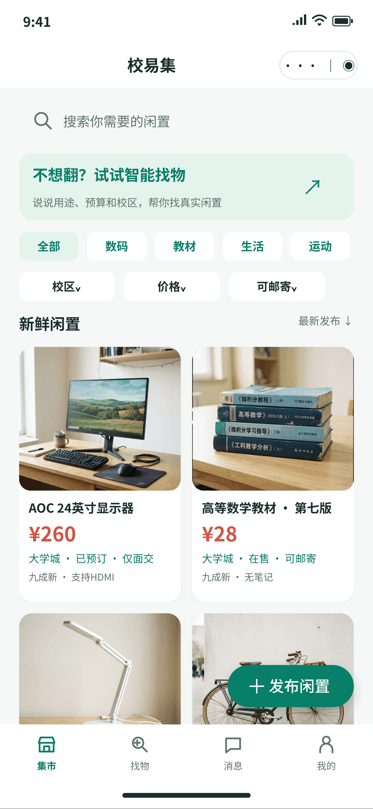
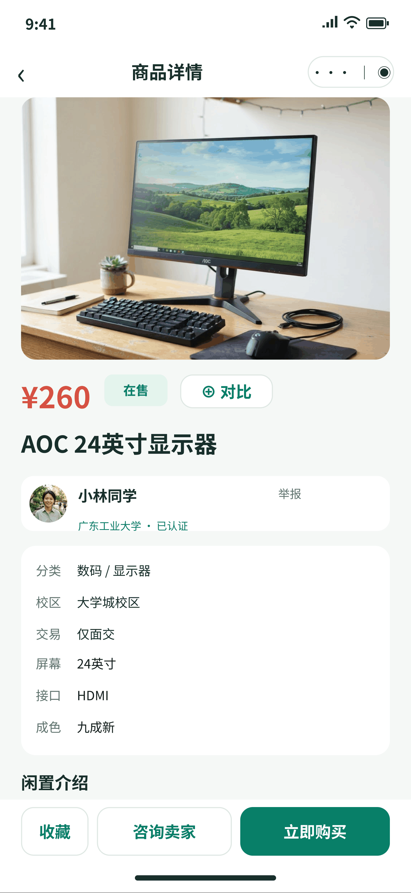
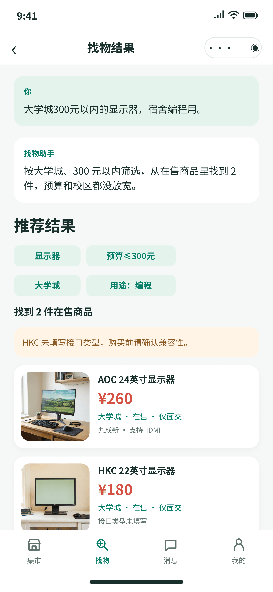
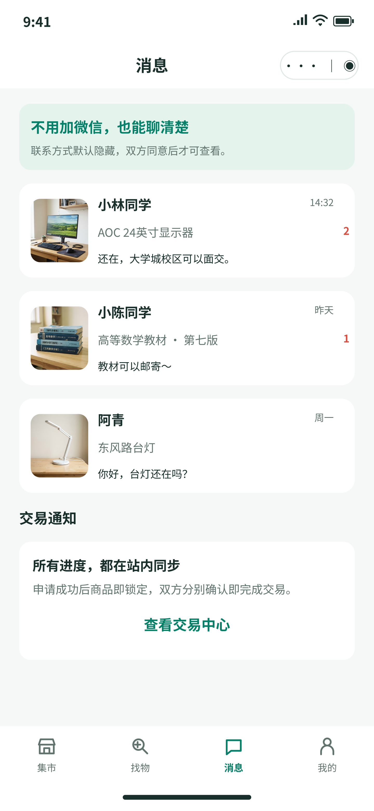
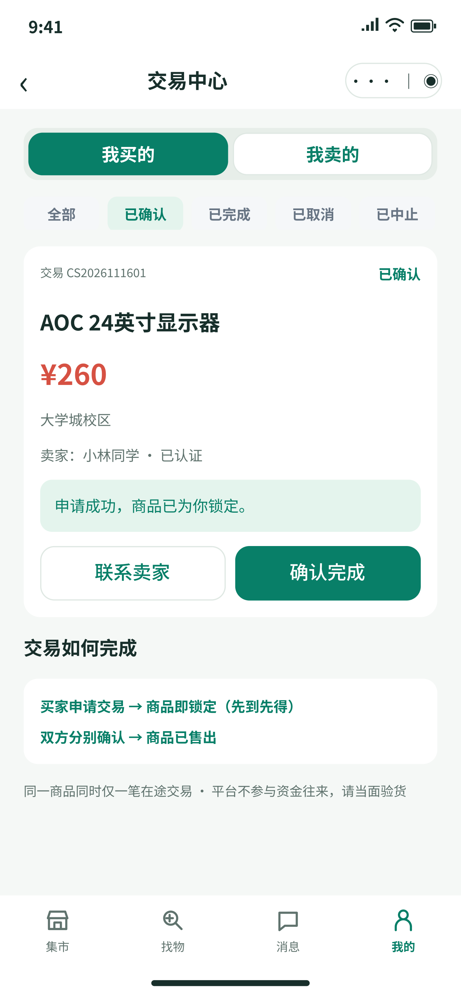
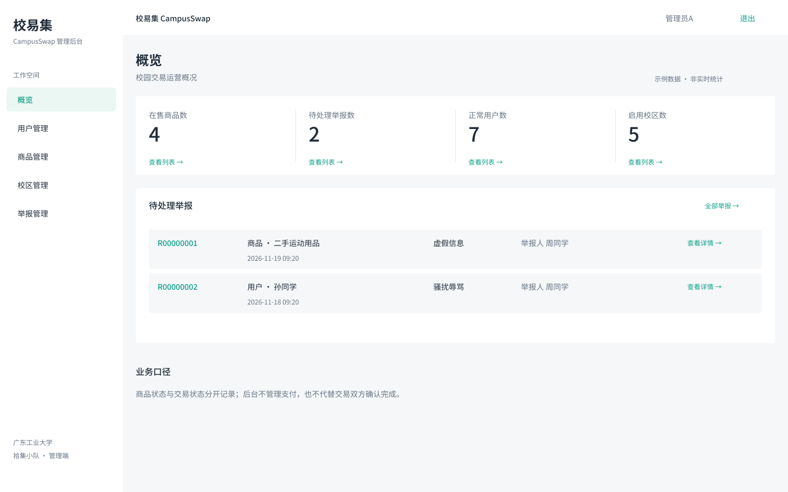

# 原型设计说明

本目录存放原型设计的相关材料：在线链接、逐页截图、交互与规则说明。

## 原型在线链接

| 端 | 链接 | 帧数 |
|---|---|---|
| 前台（学生端） | https://www.figma.com/proto/pjrY4BLAguoyZz6eo7ufbN/CampusS-11?page-id=0%3A1&node-id=2-2&p=f&scaling=scale-down&content-scaling=fixed&starting-point-node-id=2%3A2&show-proto-sidebar=1 | F01–F11，另含 F02b/F02c/F02d/F04b 与交易中心 5 个状态帧 |
| 后台（管理端） | https://www.figma.com/proto/CelIX5lzPKjj01NfFALkxq/CampusS-22?page-id=0%3A1&node-id=5-75&p=f&scaling=scale-down&content-scaling=fixed&starting-point-node-id=5%3A75&show-proto-sidebar=1 | A00–A04 |

**访问要求：** 分享设置须为「Anyone with the link → can view」，评审时不登录也能打开。验证方法是用浏览器无痕窗口打开一次；如果右上角显示 `Log in or create account`，说明是访客视角，配置正确。

**链接格式注意：** 必须是 `/proto/` 开头的 Presentation 链接，`/design/` 链接打开后是一堆画板，无法交互演示。

## 页面清单

### 前台（11 页 + 4 个状态帧）

| 编号 | 页面 | 说明 |
|---|---|---|
| F01 | 登录与校区选择 | 校区选项由接口渲染 |
| F02 | 集市首页 | 校区 / 价格 / 可邮寄筛选 |
| F02b | 集市 · 加载中 | 骨架屏 |
| F02c | 集市 · 空结果 | 三个出口：重置筛选 / 切换校区 / 关闭邮寄 |
| F02d | 集市 · 加载失败 | 重试 / 检查网络 / 修改筛选 |
| F03 | 智能找物 · 输入 | 引导气泡 + 示例需求 |
| F04 | 智能找物 · 结果 | 条件标签 + 推荐卡片 + 缺失项提示 |
| F04b | 智能找物 · 硬条件无命中 | 明确不放宽、不凑数 |
| F05 | 商品详情 | 字段绑定商品变量 |
| F06 | 智能发布 · 输入 | 图片 + 一句话 |
| F07 | 智能发布 · 草稿 | 追问 + 预填表单 |
| F08 | 消息中心与聊天 | 正常 / 被拉黑 / 空消息三变体 |
| F09 | 交易中心 | 全部 / 已确认 / 已完成 / 已取消 / 已中止 |
| F10 | 我的 | 发布五态、收藏、求购、隐私设置 |
| F11 | 商品对比 | 六维度并列 + 未填写/不适用图例 |

### 后台（5 页）

| 编号 | 页面 |
|---|---|
| A00 | 概览 |
| A01 | 用户管理 |
| A02 | 商品管理 |
| A03 | 校区管理 |
| A04 | 举报管理 |

## 关键页面截图

以下为主链路 6 页，完整 23 张（含 4 个异常态、聊天三变体、后台 5 页）见 [`screens/`](screens/)。

| 集市首页 | 商品详情 |
|---|---|
|  |  |

| 智能找物结果 | 消息中心 |
|---|---|
|  |  |

| 交易中心 | 后台概览 |
|---|---|
|  |  |

## 逐页交互规则

> 说明：原型以「点得通」为目标，凡是标了去向的元素在 Presentation 里都能真的跳过去；标注「置灰」的是实现时需按条件禁用的状态，原型里用静态样式表达。

| 页面 | 可点元素 | 点击后去向 | 禁用 / 置灰条件 | 关键提示文案 |
|---|---|---|---|---|
| F01 | 校区选项、进入按钮 | 选中校区 → 集市首页 F02 | 未选校区时「进入」置灰 | 「请先选择所在校区」 |
| F02 | 商品卡、搜索区「智能找物」入口、右下「＋ 发布闲置」、校区/价格/可邮寄筛选、底部 4 个 tab | 卡片 → F05；找物 → F03；发布 → F06；tab → F03 / F08 / F10 | 已预订、已售出卡片仍可进详情（只读） | 卡片角标「在售 / 已预订 / 已售出」；履约只写「仅面交」「可邮寄」 |
| F02b | 无（骨架屏） | — | — | 首屏请求超过 3s 进入骨架屏，超过 10s 转 F02d |
| F02c | 「重置全部筛选」「切换校区」 | → F02 | — | 标题「没有符合条件的商品」，说明「换个校区或放宽价格再试」 |
| F02d | 「重试」「检查网络」「修改筛选」 | 重试 → F02 | — | 「网络开小差了，商品列表没加载出来」 |
| F03 | 示例需求、发送按钮 | 发送 → F04 | 输入为空时发送置灰 | 占位「比如：300 元以内的显示器，能 HDMI」 |
| F04 | 推荐卡片、条件标签的删除、对比入口 | 卡片 → F05；对比 → F11 | — | 缺口提示「HKC 22英寸显示器 未填写接口类型，购买前请确认兼容性」 |
| F04b | 「放宽预算」「保存求购」「返回集市」 | 放宽 → F03；保存求购 → 求购浮层；返回 → F02 | — | 「没有完全符合条件的商品，我们不用不满足条件的商品凑数」 |
| F05 | 「咨询卖家」「立即购买」「举报」 | 咨询 → 聊天 F08a；立即购买 → 交易确认（F09） | 已售出时「立即购买」置灰 | 交易行只写「仅面交」或「可邮寄」；底部「站内沟通，见物后再确认完成」 |
| F06 | 「生成草稿」 | → F07 | 无图片或无一句话描述时置灰 | 「至少上传 1 张照片，再写一句商品描述」 |
| F07 | 「确认发布」「保存草稿」 | 确认 → F02（我的·在售）；保存 → F10 | 必填项缺失时「确认发布」置灰 | 「还差 1 项必填：面交地点」 |
| F08 | 会话行、交易通知 | → 聊天 F08a / F08d | — | 无会话时见 F08c |
| F08a / F08b / F08c | 输入框、发送、「申请交换联系方式」 | 发送后留在本帧（不跳页） | 被拉黑（F08b）时输入框与发送禁用 | 「对方已将你加入黑名单，无法继续沟通」 |
| F09 | 5 个状态标签、「联系卖家」「确认完成」「查看商品详情」 | 标签 → 对应状态帧（全部 / 已确认 / 已完成 / 已取消 / 已中止）；联系卖家 → 聊天；确认完成 → 已完成帧；查看商品详情 → F05 | 已完成 / 已取消 / 已中止没有「确认完成」 | 「申请成功，商品已为你锁定」「先到先得，商品即锁定，无需卖家再确认」 |
| F10 | 发布五态标签、收藏、求购、隐私设置 | 与底部 tab 互跳 | 无数据的分组显示空态 | 标签「草稿 / 在售 / 已预订 / 已售出 / 已下架」 |
| F11 | 返回、移除对比项 | → F04 | 少于 2 件时不可对比 | 图例「未填写」「不适用」 |
| A00–A04 | 侧栏 5 项、行内「查看详情 / 下架 / 驳回 / 封禁」 | 侧栏 → 对应页面 | A02 里已预订的商品「强制下架」置灰，交易结束前不可下架 | hover 气泡「已预订，交易结束前不可下架」 |

## 四种异常态的处理口径

| 异常态 | 对应帧 | 触发条件 | 界面处理 | 用户出口 |
|---|---|---|---|---|
| 加载中 | F02b | 首屏请求 3s 未返回 | 骨架屏占位，不显示转圈文字，避免"白屏" | 无需操作，返回后自动渲染 |
| 空结果 | F02c / F08c / F04b | 查询命中 0 条 | 区分两类：筛选后为空（F02c、F08c）与硬条件不满足（F04b）。前者给"重置筛选"出口，后者**明确不放宽条件、不用近似商品凑数** | 重置筛选 / 切换校区 / 保存求购 |
| 接口失败 | F02d | 请求报错或超时 10s | 保留原筛选条件，整页可重试，不弹 toast 打断 | 重试 / 检查网络 / 修改筛选 |
| 智能体不可用 | 状态浮层「智能体服务不可用」 | 大模型超时或返回异常 | 降级为关键词搜索，已输入内容不丢，不假装"没找到" | 改用关键词搜索 / 重试 |

> 一致性要求：任何异常态都不得清空用户已填内容；任何"没有结果"的文案都必须说清是"没搜到"还是"条件太严"，不能让用户误以为是商品真的不存在。

## 截图

原型截图存放于 `screens/`，命名与服务端图号对应（`F01-login.png` 等）。

**为什么必须提交截图：** 助教打开仓库第一眼看到的是 README 与 docs 目录。如果这里只有一句「原型见 Figma」，他需要额外点外链、等加载、再找画板。把关键页面直接嵌进文档，评审体验完全不同。

截图规范：

- 宽度 1440px，单张控制在 500KB 以内
- 命名为 `编号-语义名.png`，与上表编号一致
- 至少提交主链路 5 页：F01、F02、F04、F05、F08

## 走查记录

原型走查的逐页核对结论见 [`../05-原型走查记录.md`](../05-原型走查记录.md)，UI 侧的核对回复见 [`../06-走查问题核对与修复说明.md`](../06-走查问题核对与修复说明.md)。

两份记录的分工：走查记录以截图判读为主，UI 侧回复以 Figma 文件结构（图层、变量、reactions）为准。两者结论不一致时，以文件结构为准。
